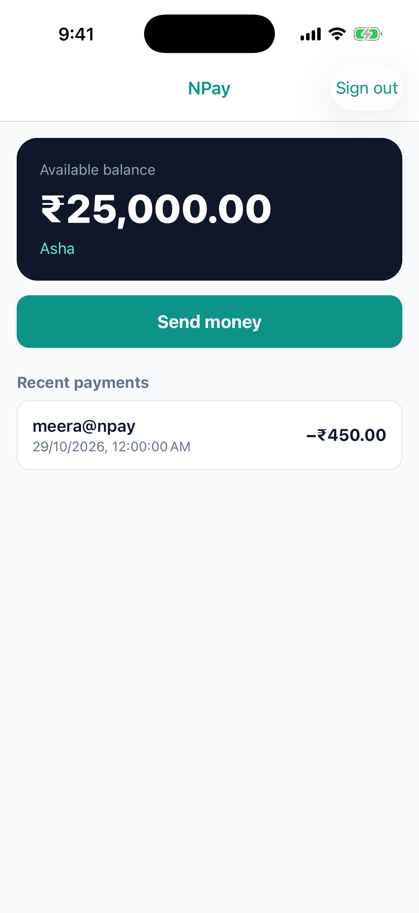
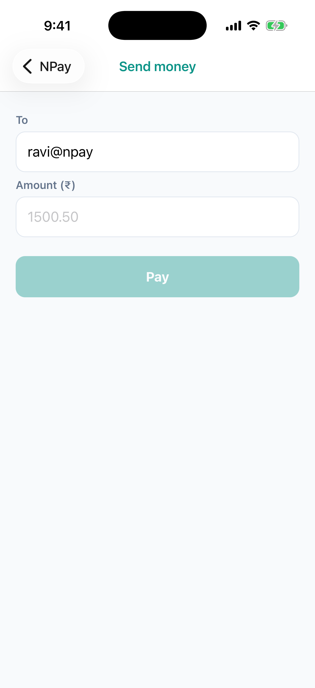
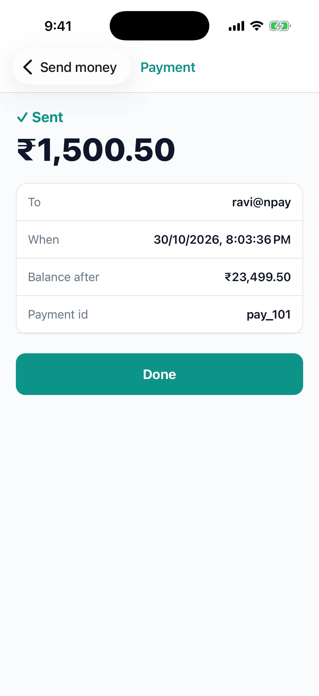
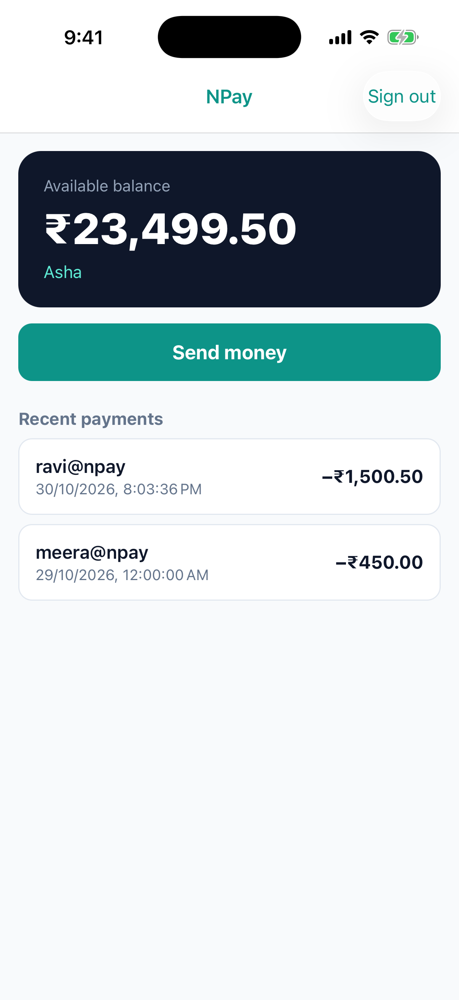
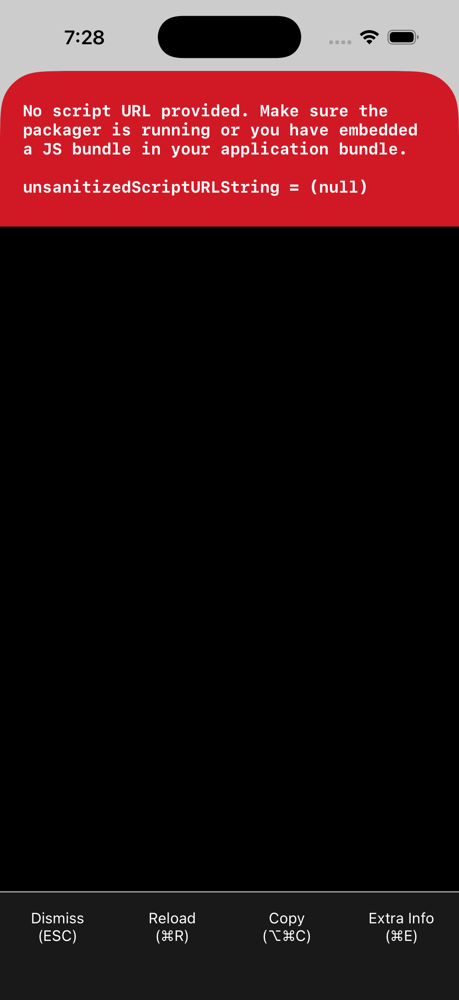

# Lab 1 · Build and run the base app

**Goal:** build the NPay base app for the iOS Simulator and understand the two things that must run:
the **native app** (built by Xcode) and **Metro** (serves your JavaScript). The app also needs its backend, the
**NPay server**.

You will finish with NPay running and a payment sent, and you will prove where its JavaScript comes from.

| | |
|---|---|
| App | `~/npay-workshop/NPayRN` (branch `main`) (React Native 0.87.1, React Native CLI, not Expo) |
| Bundle id | `com.npay.workshop` |
| You need | Xcode (26.x used here), an iPhone Simulator, Node.js 22.11 or newer |

---

## 1 · Install CocoaPods the project's way (Bundler)

React Native's iOS dependencies are CocoaPods pods. The project pins the CocoaPods version in its `Gemfile`.
Install it **into the project**, not into the system:

```sh
cd ~/npay-workshop/NPayRN
bundle config set --local path vendor/bundle
bundle install
```

Expect: `Bundle complete! … Bundled gems are installed into ./vendor/bundle`.
On macOS's own Ruby 2.6 this picks **CocoaPods 1.15.2**, which still runs on 2.6. No Homebrew and no `sudo` needed.

## 2 · Install the pods

```sh
cd ios
bundle exec pod install
```

Expect: `Pod installation complete! There are 88 dependencies from the Podfile and 87 total pods installed.`

Read the output, two lines matter:

- `Please close any current Xcode sessions and use NPayRN.xcworkspace for this project from now on.`
  → from now on you open and build the **`.xcworkspace`** (your app + the Pods project), never the `.xcodeproj`.
- `Calling pod install directly is deprecated in React Native because we are moving away from Cocoapods`
  → it still works in 0.87; React Native is moving to other build tooling.

## 3 · Start the NPay server (terminal 0, leave it open)

```sh
cd ~/npay-workshop/server
./mvnw spring-boot:run          # needs Java 21
```

It prints every request it gets. Sign-in: **asha / npay-demo**.

## 3b · Start Metro (terminal 1, leave it open)

```sh
cd ~/npay-workshop/NPayRN
npx react-native start
```

Check it from another terminal:

```sh
curl localhost:8081/status
# packager-status:running
```

## 4 · Build the native app (terminal 2)

The shortcut is `npx react-native run-ios`. Here we run the real build command, to see what it does:

```sh
cd ~/npay-workshop/NPayRN/ios
xcodebuild -workspace NPayRN.xcworkspace -scheme NPayRN -configuration Debug \
  -sdk iphonesimulator -destination 'platform=iOS Simulator,name=iPhone 17 Pro' \
  -derivedDataPath build build
```

Expect: `** BUILD SUCCEEDED **`.
(Use any Simulator from `xcrun simctl list devices available`.)

## 5 · Install and launch

```sh
xcrun simctl boot "iPhone 17 Pro"; open -a Simulator
xcrun simctl install "iPhone 17 Pro" build/Build/Products/Debug-iphonesimulator/NPayRN.app
xcrun simctl launch "iPhone 17 Pro" com.npay.workshop
```

Expect the NPay sign-in screen. Metro's terminal shows `BUNDLE ./index.js`: the app just asked Metro for its JavaScript.

Then use it:

1. Sign in as **asha / npay-demo** (a wrong password shows "Wrong username or password").
2. Home shows **₹25,000.00** and one past payment.
3. **Send money** → ravi@npay, **1500.50** → **Pay** → **✓ Sent ₹1,500.50**, balance after **₹23,499.50**.
4. **Done** → Home shows **₹23,499.50** and the new payment. The server terminal shows each request.

| | | | | |
|---|---|---|---|---|
|  |  |  |  |  |

## 6 · Look inside the app you built

```sh
APP=build/Build/Products/Debug-iphonesimulator/NPayRN.app
ls $APP/Frameworks
# hermesvm.framework  React.framework  ReactNativeDependencies.framework  (+ RNScreens' code is linked into the app)
ls $APP | grep jsbundle || echo "no JS bundle inside"
# no JS bundle inside
```

- `React.framework` and `ReactNativeDependencies.framework`: React Native itself, shipped **prebuilt** by the pods
  (that is why the build compiled only a few files of its own).
- `hermesvm.framework`: the Hermes JavaScript engine.
- **No `main.jsbundle`**: a Debug build carries no JavaScript. It loads it from Metro at launch.

## 7 · Test it: where does the JavaScript come from?

1. Stop Metro (Ctrl-C in terminal 1).
2. Relaunch the app:
   ```sh
   xcrun simctl terminate "iPhone 17 Pro" com.npay.workshop
   xcrun simctl launch "iPhone 17 Pro" com.npay.workshop
   ```
   Expect the red screen (shown here on the template app, before the NPay screens; NPay shows the same):
   > **No script URL provided. Make sure the packager is running or you have embedded a JS bundle in your application bundle.**

   
3. Start Metro again (`npx react-native start`), then press **Reload (⌘R)** in the Simulator or relaunch.
   The app is back.

## Checklist

| Check | Pass when |
|---|---|
| Server | `./mvnw spring-boot:run` shows its requests |
| Pods installed | `ios/Pods/` exists and `NPayRN.xcworkspace` was created |
| Metro running | `curl localhost:8081/status` → `packager-status:running` |
| Build | `** BUILD SUCCEEDED **` |
| App runs | sign in, ₹25,000.00, pay ₹1,500.50 → ₹23,499.50 |
| Inside the app | three frameworks, no `main.jsbundle` |
| Without Metro | the red "No script URL provided" screen |

> **Background:** [lab1-concepts.md](lab1-concepts.md) explains CocoaPods, Bundler, `vendor/`, SDKs and how the JS bundle gets into the app.

## Answer before Lab 2

1. Why do we open `NPayRN.xcworkspace` and not `NPayRN.xcodeproj`?
2. The Debug app has no JavaScript inside. Where does it get it, and what happens when that is missing?
3. Which file decides the CocoaPods version, and where did Bundler install it?
4. How will a build that runs **without** Metro (for TestFlight) have to be different? (Lab 2 answers this.)

## If something goes wrong

| You see | Do this |
|---|---|
| `gem install cocoapods` fails on Ruby 2.6 | don't install it globally: use `bundle install` (step 1) |
| `Unable to lookup in current state: Shutdown` | the Simulator is off: `xcrun simctl boot "iPhone 17 Pro"` |
| Red "No script URL provided" | Metro is not running: start it, then Reload (⌘R) |
| "Can’t reach NPay. Is the server running?" | start the server (step 3) |
| Build errors after changing native dependencies | `cd ios && bundle exec pod install`, then build again |
