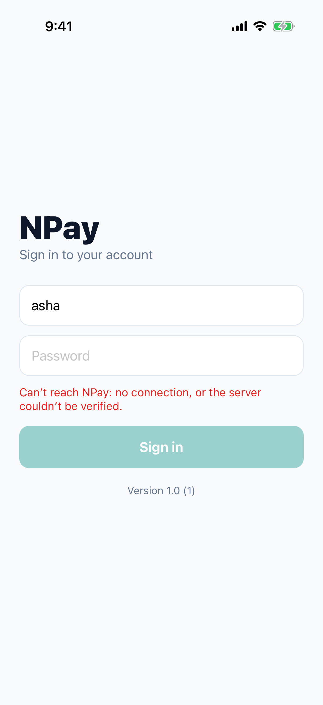
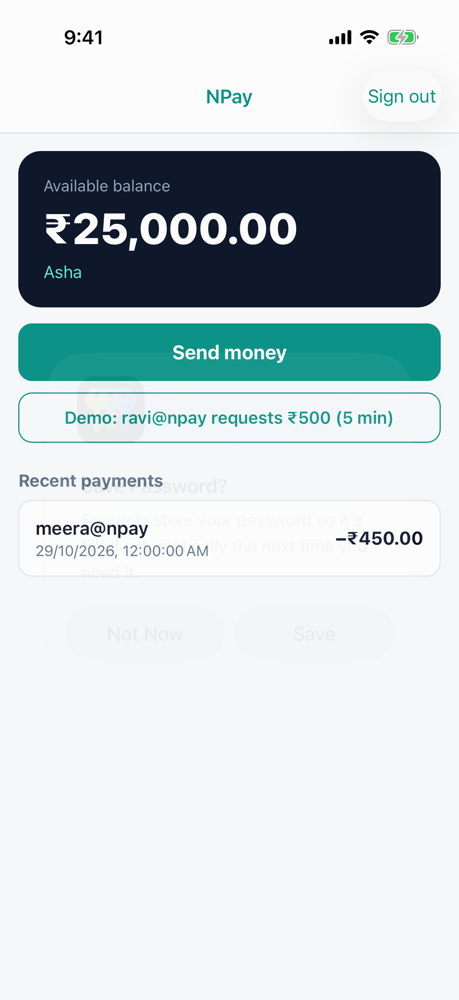
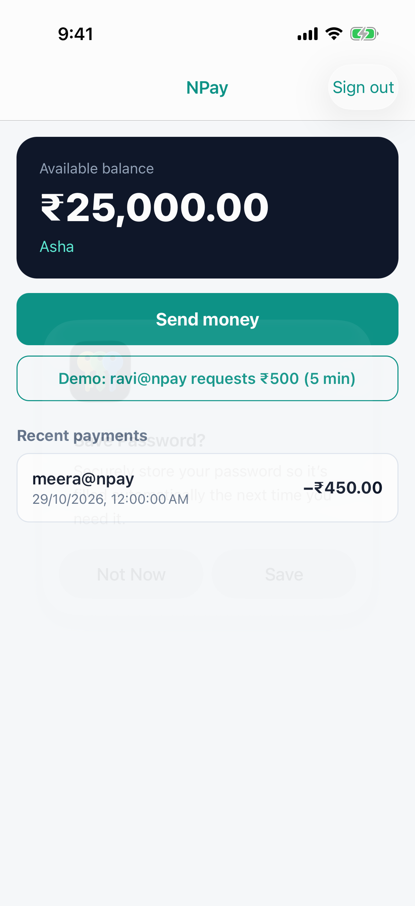

# Lab 10 · HTTPS and certificate pinning

**Branch:** `lab-10` (built on `lab-09`) · **Account:** none needed

**Goal:** the production build talks to its server over **HTTPS**, and it refuses to talk to anyone *pretending* to
be that server, even when the phone has been made to trust the impostor. That second part is **certificate
pinning**, and for a React Native app it is one entry in Info.plist: no networking code.

| | Before | After |
|---|---|---|
| Release (production) | `http://localhost:8080`: anyone on the path reads everything | **`https://localhost:8443`** |
| an inspecting proxy the phone trusts (Charles, mitmproxy, a company proxy, malware's profile) | reads the password and every token | **refused**: the server's key doesn't match NPay's **pin** |

Debug (`http://localhost:8080`) and Staging (`http://localhost:8090`) stay plain HTTP for development: App Transport
Security allows that only for local addresses (`NSAllowsLocalNetworking`); a real domain would need HTTPS.

## The pieces

| Piece | File | What it is |
|---|---|---|
| a demo **root CA** | `certs/ca.crt` | stands in for a public CA (Let's Encrypt, DigiCert…): the phone trusts it |
| the **server's certificate** | `certs/server.p12` | `localhost`, signed by that CA, used by the `https` profile (:8443) |
| an **inspecting proxy** | `server/…/InspectingProxy.java`, `certs/proxy-ca.crt`, `certs/proxy.p12` | the `proxy` profile (:8444): decrypts, **logs**, forwards to :8443. Its certificate comes from its *own* root, "Proxy Inspector Root CA" |
| the **pin** | `NPayRN/ios/NPayRN/Info.plist` › `NSPinnedDomains` | SHA-256 of the server's **public key**: the only key NPay accepts for `localhost` |

`certs/make-certs.sh` made the certificates and printed the pins. **Demo only: never ship these keys.**

## What changed on this branch

```sh
git diff lab-09 lab-10 --stat
```

| File | Change |
|---|---|
| `certs/*` (new) | the demo CAs, certificates and `make-certs.sh` / `install-ca.sh` |
| `server/…/application-https.properties`, `application-proxy.properties`, `InspectingProxy.java` (new) | the HTTPS server and the attacker |
| `server/…/*Controller.java`, `Gate.java`, `ApiErrors.java` | `@Profile("!proxy")`: the proxy profile runs only the proxy |
| `NPayRN.xcodeproj` | Release: `NPAY_SERVER_URL = https://localhost:8443` |
| `NPayRN/Info.plist` | **`NSPinnedDomains`** (below) |
| `src/screens/SignInScreen.tsx` | the error now says *no connection, or the server couldn't be verified* (`fetch` reports both the same way) |

### The pin, in Info.plist

```xml
<key>NSAppTransportSecurity</key>
<dict>
  <key>NSAllowsArbitraryLoads</key><false/>
  <key>NSAllowsLocalNetworking</key><true/>
  <key>NSPinnedDomains</key>
  <dict>
    <key>localhost</key>
    <dict>
      <key>NSIncludesSubdomains</key><false/>
      <key>NSPinnedLeafIdentities</key>
      <array>
        <dict>
          <key>SPKI-SHA256-BASE64</key>
          <string>XsGc8vZ13V78LLwOhDb8aFLLLnl8bg6kYPDLMVdN1+s=</string>   <!-- the server's public key -->
        </dict>
      </array>
    </dict>
  </dict>
</dict>
```

iOS's networking (`NSURLSession`) checks this on **every** connection to `localhost`, and React Native's `fetch` uses
`NSURLSession`, so all of NPay's API calls are pinned. The pin is computed from the certificate:

```sh
openssl x509 -in certs/server.crt -pubkey -noout | openssl pkey -pubin -outform DER | openssl dgst -sha256 -binary | base64
# XsGc8vZ13V78LLwOhDb8aFLLLnl8bg6kYPDLMVdN1+s=
```

---

## Run it

```sh
cd ~/npay-workshop && git checkout lab-10
cd NPayRN/ios && bundle exec pod install          # only if you switched branches
```

**Terminal 1, the real server over HTTPS** (stop any older server first):

```sh
cd ~/npay-workshop/server && ./mvnw spring-boot:run -Dspring-boot.run.profiles=https     # :8443
```

**Terminal 2, the attacker** (an inspecting proxy that forwards to :8443 and prints what it sees):

```sh
cd ~/npay-workshop/server && ./mvnw spring-boot:run -Dspring-boot.run.profiles=proxy     # :8444
```

**Terminal 3: two Release builds** (no Metro needed: the JS is inside). The second is told to use the proxy, with
Lab 3's build setting given **on the command line**:

```sh
cd ~/npay-workshop/NPayRN/ios
xcodebuild -workspace NPayRN.xcworkspace -scheme NPayRN -configuration Release -sdk iphonesimulator \
  -destination 'platform=iOS Simulator,name=iPhone 17 Pro' -derivedDataPath build build \
  2>&1 | grep -E "error:|BUILD (SUCCEEDED|FAILED)"
xcodebuild -workspace NPayRN.xcworkspace -scheme NPayRN -configuration Release -sdk iphonesimulator \
  -destination 'platform=iOS Simulator,name=iPhone 17 Pro' -derivedDataPath /tmp/npay-viaproxy \
  NPAY_SERVER_URL=https://localhost:8444 build 2>&1 | grep -E "error:|BUILD (SUCCEEDED|FAILED)"
REAL=build/Build/Products/Release-iphonesimulator/NPayRN.app
VIA=/tmp/npay-viaproxy/Build/Products/Release-iphonesimulator/NPayRN.app
```

For each step below, install the app it names, launch it, and sign in (**asha / npay-demo**):

```sh
xcrun simctl boot "iPhone 17 Pro"; open -a Simulator
xcrun simctl uninstall "iPhone 17 Pro" com.npay.workshop
xcrun simctl install "iPhone 17 Pro" $REAL        # or $VIA, or the no-pin copy in step 4
xcrun simctl launch "iPhone 17 Pro" com.npay.workshop
```

The results below are `evidence/10-results.txt`.

## 1 · HTTPS: an untrusted certificate is refused

Install `$REAL`, sign in → *"Can't reach NPay: no connection, or the server couldn't be verified."* The phone doesn't
trust "NPay Demo Root CA" yet. (A real server's certificate comes from a CA iOS already trusts, so this step doesn't
happen in production.)

## 2 · Trust the CA: it works

```sh
xcrun simctl keychain "iPhone 17 Pro" add-root-cert ~/npay-workshop/certs/ca.crt     # like installing a CA profile
```

Sign in again → **Home** over `https://localhost:8443`.

| 1 · not trusted | 2 · trusted |
|---|---|
|  |  |

## 3 · A proxy in the middle, not trusted: refused

Install `$VIA` (talks to :8444), sign in → refused. The proxy's certificate comes from "Proxy Inspector Root CA",
which the phone doesn't trust. **This is what HTTPS gives you.** The proxy's terminal stays empty.

## 4 · The phone trusts the proxy, no pinning: it reads everything

Someone talks the user into installing the proxy's profile (or a company proxy, or malware):

```sh
xcrun simctl keychain "iPhone 17 Pro" add-root-cert ~/npay-workshop/certs/proxy-ca.crt
```

To see the danger, use a copy of `$VIA` **without** the pin (iOS lets the Simulator run a re-signed copy):

```sh
rm -rf /tmp/nopin && mkdir /tmp/nopin && cp -R $VIA /tmp/nopin/
/usr/libexec/PlistBuddy -c "Delete :NSAppTransportSecurity:NSPinnedDomains" /tmp/nopin/NPayRN.app/Info.plist
codesign --force --sign - --preserve-metadata=entitlements /tmp/nopin/NPayRN.app
```

Install `/tmp/nopin/NPayRN.app`, sign in → **Home**, and the **proxy's terminal** shows (`evidence/10-proxy-log-no-pin.txt`):

```
PROXY sees  POST /v1/login
            body: {"username":"asha","password":"npay-demo"}
PROXY sees  GET /v1/account
            Authorization: Bearer at_…
PROXY sees  GET /v1/payments
            Authorization: Bearer at_…
```

**HTTPS was on the whole time.** The connection was encrypted, but to the proxy, which the phone had been told to trust.

## 5 · The same, with NPay's pin: refused

Install `$VIA` (it has the pin), sign in → refused, and the **proxy saw 0 requests**: NPay hung up before sending
anything. iOS's own log says why (`evidence/10-pinned-ios-log.txt`):

```
(Security) Trust evaluate failure: [leaf LeafSPKISHA256]
(CFNetwork) … HTTP load failed, 0/0 bytes (error code: -1202 [3:-9807])
(CFNetwork) … NSURLErrorDomain Code=-1202 "The certificate for this server is invalid. You might be connecting to a
              server that is pretending to be …"
```

`LeafSPKISHA256`: the server's public key didn't match the pin. To see the log yourself:

```sh
xcrun simctl spawn "iPhone 17 Pro" log stream --level debug --predicate 'process == "NPayRN"' | grep -E "Trust evaluate|-1202"
```

| 3 · proxy not trusted | 4 · proxy trusted, no pin | 5 · proxy trusted, pinned |
|---|---|---|
|  |  |  |

## Pinning has a price: plan the next key

A pin is a promise about the future: if the server gets a **new key** (a renewed certificate with a new key pair) and
the app only knows the old pin, **every installed app stops working** until users update.

- Ship **two** pins: the current key and the **next** one (a backup key generated now and kept offline); add more
  `NSPinnedLeafIdentities` entries.
- Or pin the **CA** you buy certificates from (`NSPinnedCAIdentities`): survives renewals, but trusts everything that
  CA signs.
- Keep a way out: pin only what you control, and test renewals before they happen.

## How these results were made

`sh scripts/lab10-run.sh` erases the Simulator, starts the https and proxy servers, builds both Release apps and the
no-pin copy, trusts the roots in order, and the UI driver signs in for each case, counting the proxy's log lines.

## Checklist

| Check | Pass when |
|---|---|
| HTTPS | `$REAL` signs in only after `ca.crt` is trusted |
| proxy, not trusted | refused; the proxy logs nothing |
| proxy trusted, no pin | signs in; the proxy logs the password and tokens |
| proxy trusted, pinned | refused; the proxy logs nothing; iOS logs `Trust evaluate failure: [leaf LeafSPKISHA256]` |

## Answer before Lab 11

1. What does HTTPS protect against, and what does it *not* protect against?
2. How can a phone end up trusting a proxy?
3. What exactly is pinned: the certificate, the key, or the domain? Why the key?
4. Why does pinning in Info.plist also cover React Native's `fetch`?
5. The server's certificate is renewed next year with a new key. What happens to installed apps, and how do you
   prepare?

## If something goes wrong

| You see | Do this |
|---|---|
| step 2 still refused | `add-root-cert` went to a different Simulator: use the booted one's name; relaunch NPay |
| `curl: (60) SSL certificate problem` when testing the server | pass `--cacert ~/npay-workshop/certs/ca.crt` (or `proxy-ca.crt` for :8444) |
| the proxy logs nothing in step 4 | you installed `$VIA` (pinned) instead of the no-pin copy, or the proxy's root isn't trusted |
| `Port 8443 was already in use` | another server is running: stop it |
| everything refused after re-running `make-certs.sh` | new keys = new pins: update `NSPinnedDomains` with the printed server pin, rebuild, trust the new `ca.crt` |
