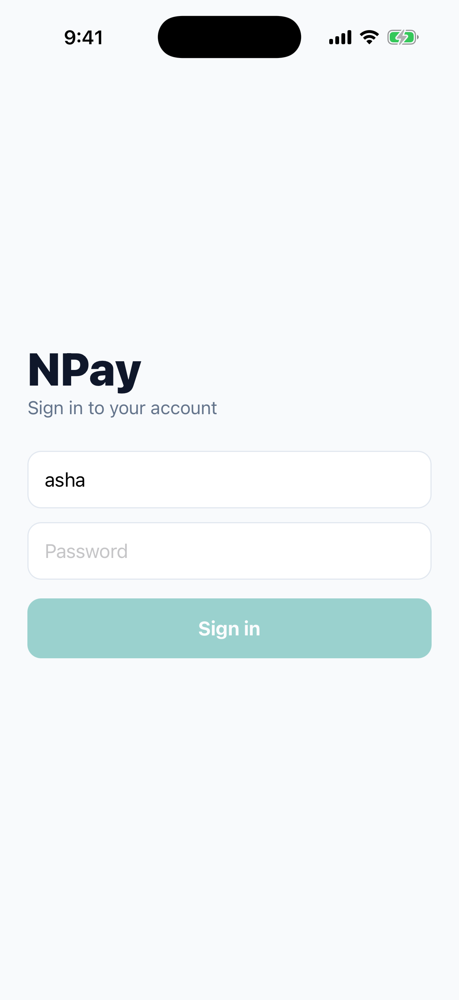
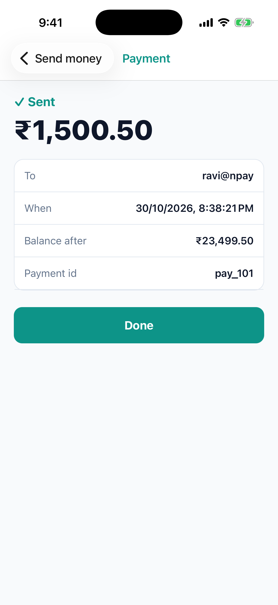
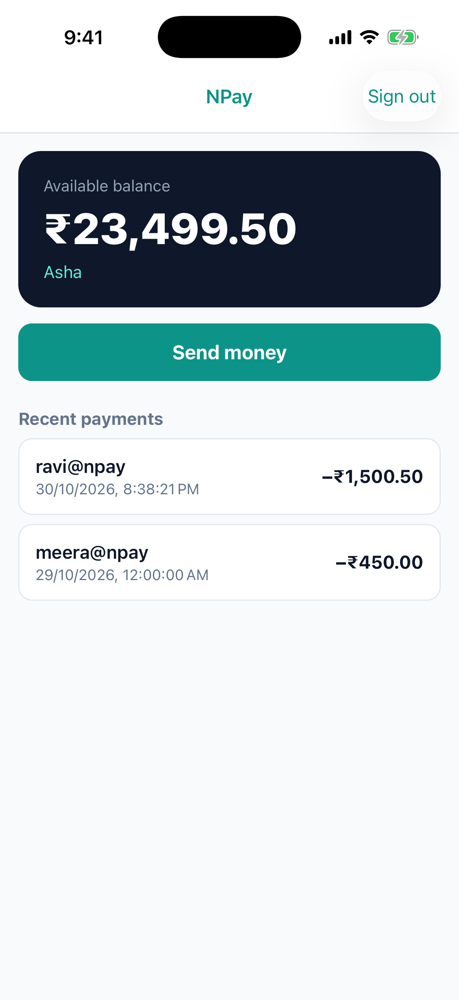

# Lab 2 · Release build: the JavaScript goes inside the app

**Branch:** `lab-02` (built on `main`) · **Background:** [lab1-concepts.md](lab1-concepts.md) §7

**Goal:** build NPay in the **Release** configuration and prove that its JavaScript is now **inside the app**, as
Hermes bytecode, so it runs **without Metro**. That is the build TestFlight and the App Store need.

| | Debug (Lab 1) | Release (this lab) |
|---|---|---|
| JS inside the app | no | `main.jsbundle` |
| where JS comes from at launch | Metro, `localhost:8081` | the app itself |
| without Metro | red "No script URL provided" | works |

**What this lab changes in the code:** one line in `NPayRN/package.json`, a shortcut:

```json
"ios:release": "react-native run-ios --mode Release --no-packager",
```

`--mode Release` picks the Release build configuration; `--no-packager` doesn't start Metro (Release doesn't need it).

---

## 1 · Start the server only (not Metro)

```sh
cd ~/npay-workshop/server && ./mvnw spring-boot:run
```

Make sure Metro is **not** running:

```sh
curl -s -m 2 localhost:8081/status || echo "metro: NOT running"
# metro: NOT running
```

## 2 · Build Release

The explicit way, to watch it:

```sh
cd ~/npay-workshop/NPayRN/ios
xcodebuild -workspace NPayRN.xcworkspace -scheme NPayRN -configuration Release \
  -sdk iphonesimulator -destination 'platform=iOS Simulator,name=iPhone 17 Pro' \
  -derivedDataPath build build > release.log
grep -E "BUILD SUCCEEDED|Writing bundle output|Done writing bundle|hermesc -emit-binary" release.log
```

Expect, among the lines:

```
LOG:Writing bundle output to: …/Release-iphonesimulator/main.jsbundle
LOG:Done writing bundle output
… hermesc -emit-binary -max-diagnostic-width=80 -O -out …/main.jsbundle …
** BUILD SUCCEEDED **
```

That is the **"Bundle React Native code and images"** build step at work, in two moves:
1. **Metro's bundler** runs once, no server (`bundle.js bundle --entry-file index.js --platform ios --dev false`), and
   writes all your JS into `main.jsbundle`.
2. **`hermesc`**, the Hermes compiler, turns it into **bytecode** (`-emit-binary`, `-O` = optimised).

(You will also see `warning: the variable "Promise" was not declared…` from hermesc. They are about React Native's
own code and are harmless.)

## 3 · Look inside the Release app

```sh
cd build/Build/Products
ls Release-iphonesimulator/NPayRN.app
# … Frameworks  Info.plist  main.jsbundle  NPayRN  assets …

file Release-iphonesimulator/NPayRN.app/main.jsbundle
# main.jsbundle: Hermes JavaScript bytecode, version 98

ls Debug-iphonesimulator/NPayRN.app | grep -c jsbundle      # 0: Debug has none
ls Release-iphonesimulator/NPayRN.app | grep -c jsbundle    # 1
```

From the run behind this lab: `main.jsbundle` is **1,705,755 bytes**; the Release app is **42 MB**, the Debug app
**83 MB** (Debug carries extra developer tooling and unoptimised code).

**Bytecode is not encryption.** Your strings are still readable:

```sh
strings Release-iphonesimulator/NPayRN.app/main.jsbundle | grep -c "Sign in to your account"   # 1
strings Release-iphonesimulator/NPayRN.app/main.jsbundle | grep -c "localhost:8080"            # 1
```

Anyone with the app can read them, so **never put secrets in JS**. Lab 9 comes back to this.

## 4 · Run it with Metro stopped

```sh
xcrun simctl install "iPhone 17 Pro" Release-iphonesimulator/NPayRN.app
xcrun simctl launch "iPhone 17 Pro" com.npay.workshop
```

Expect the NPay sign-in screen, **no red screen**. Sign in as **asha / npay-demo**, send **₹1,500.50** to ravi@npay:
**✓ Sent**, Home shows **₹23,499.50**. The server terminal shows every request; Metro saw nothing because it isn't running.

| Release, no Metro | after paying | Home |
|---|---|---|
|  |  |  |

## 5 · The shortcut

```sh
cd ~/npay-workshop/NPayRN
npm run ios:release -- --simulator "iPhone 17 Pro"
```

Expect:

```
info Building (using "xcodebuild -workspace NPayRN.xcworkspace -configuration Release -scheme NPayRN …")
success Successfully built the app
info Launching "com.npay.workshop"
success Successfully launched the app
```

Same build as step 2; the CLI puts it in Xcode's default DerivedData folder instead of `ios/build`.

## 6 · Why does the app know where to look?

`ios/NPayRN/AppDelegate.swift`, unchanged since the template:

```swift
override func bundleURL() -> URL? {
#if DEBUG
    RCTBundleURLProvider.sharedSettings().jsBundleURL(forBundleRoot: "index")   // ask Metro
#else
    Bundle.main.url(forResource: "main", withExtension: "jsbundle")              // the file inside the app
#endif
}
```

`DEBUG` is set only in the Debug configuration. So the same Swift file asks Metro in Debug and loads the file in Release.

## Checklist

| Check | Pass when |
|---|---|
| Release build | `** BUILD SUCCEEDED **`, with "Writing bundle output" and `hermesc -emit-binary` in the log |
| JS inside | `file main.jsbundle` → `Hermes JavaScript bytecode` |
| Debug vs Release | Debug app: no `main.jsbundle`; Release app: one |
| No Metro needed | Metro stopped, the app signs in and pays |
| Shortcut | `npm run ios:release` builds and launches without starting Metro |

## Answer before Lab 3

1. Which build step puts the JS into the app, and what two tools does it run?
2. Why is the Release `main.jsbundle` not a secret, and what does that mean for API keys?
3. You change a `.tsx` file and want to see it in a **Release** build. What must you do? (In Debug you just save.)
4. The app now always talks to `localhost:8080`. How would a Release build for testers point at a different server
   without changing JS by hand? (Lab 3.)

## If something goes wrong

| You see | Do this |
|---|---|
| `error: File … main.jsbundle does not exist … your release application won't work!` | Metro's bundler failed: scroll up in the log for the JS error (often a syntax/import error) |
| `Hermes is enabled but the hermesc binary could not be found` | `cd ios && bundle exec pod install`, then build again |
| Release app shows an old version of your JS | Release has no hot reload: rebuild (`npm run ios:release`) |
| "Can’t reach NPay. Is the server running?" | start the server (step 1) |
