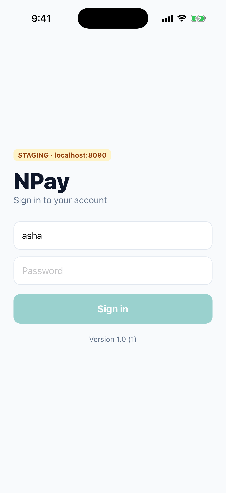
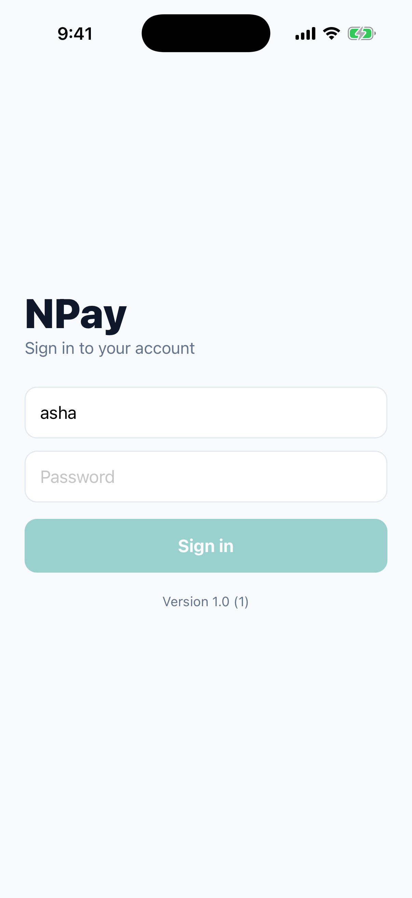
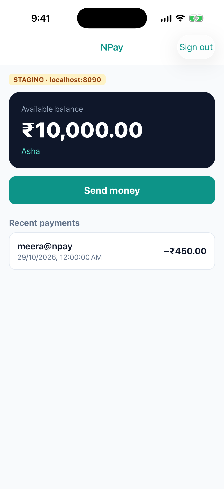
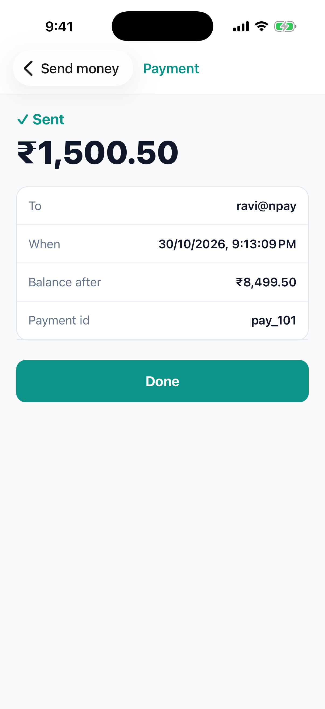

# Lab 3 · Staging and Production: one app, a server per build

**Branch:** `lab-03` (built on `lab-02`)

**Goal:** the **same app** talks to a **different server** depending on how it was built, chosen by Xcode's
**build configuration**, not by editing JS. And meet the app's **first Swift native module**, which tells
JavaScript which server to use.

| Build configuration | Environment | Server | JS from | Badge in the app |
|---|---|---|---|---|
| **Debug** | development | `http://localhost:8080` | Metro | `DEVELOPMENT · localhost:8080` |
| **Staging** (new) | staging | `http://localhost:8090` | inside the app | `STAGING · localhost:8090` |
| **Release** | production | `http://localhost:8080`* | inside the app | none |

\* In a real app production is `https://api.…`. Here the local server stands in for it; HTTPS comes in Lab 10.

## What changed on this branch

```sh
git diff lab-02 lab-03 --stat
```

| File | Change | Why |
|---|---|---|
| `ios/NPayRN.xcodeproj/project.pbxproj` | a new **Staging** configuration (a copy of Release); two build settings per configuration: `NPAY_ENVIRONMENT`, `NPAY_SERVER_URL`; two new files in the app target | Xcode decides the environment at build time |
| `ios/NPayRN/Info.plist` | `NPayEnvironment = $(NPAY_ENVIRONMENT)`, `NPayServerURL = $(NPAY_SERVER_URL)` | Xcode replaces `$(…)` with the build setting's value while building |
| `ios/NPayRN/AppConfig.swift` + `AppConfig.m` | **the native module**: reads those two Info.plist values (plus version and build) and gives them to JS | JS cannot read Info.plist by itself |
| `ios/Podfile` (+ `Podfile.lock`) | `project 'NPayRN', 'Debug' => :debug, 'Staging' => :release, 'Release' => :release` | tells CocoaPods Staging is a Release-style build, so the pods get a Staging configuration too |
| `src/config.ts` | reads `NativeModules.AppConfig`; stops the app with a clear error if it is missing | one place for "which server" |
| `src/api.ts` | `BASE_URL = config.serverURL` (was hard-coded `localhost:8080`) | |
| `src/EnvironmentBadge.tsx`, Sign-in and Home screens | the badge; "Version 1.0 (1)" on sign-in | testers can always see which server they're on |
| `package.json` | `"ios:staging": "react-native run-ios --mode Staging --no-packager"` | |
| `server/…/Bank.java`, `application-staging.properties` | starting balance is a setting; the `staging` profile runs on **:8090** with **₹10,000** | so you can *see* which server answered |

### The path, end to end

```
Xcode build configuration (Staging)
  └─ build setting  NPAY_SERVER_URL = http://localhost:8090
       └─ Info.plist  NPayServerURL = $(NPAY_SERVER_URL)  →  "http://localhost:8090" in the built app
            └─ AppConfig.swift  constantsToExport()  reads Info.plist
                 └─ JS  NativeModules.AppConfig.serverURL  →  src/config.ts  →  api.ts BASE_URL
```

### The native module, explained

```swift
@objc(AppConfig)                                   // the name JavaScript sees
final class AppConfig: NSObject {
  @objc func constantsToExport() -> [AnyHashable: Any] {   // values JS gets as constants
    let info = Bundle.main.infoDictionary ?? [:]
    return ["environment": info["NPayEnvironment"] as? String ?? "unknown",
            "serverURL":   info["NPayServerURL"] as? String ?? "", …]
  }
  @objc static func requiresMainQueueSetup() -> Bool { false }   // no UI work: any thread is fine
}
```

```objc
// AppConfig.m: registers the Swift class with React Native
#import <React/RCTBridgeModule.h>
@interface RCT_EXTERN_MODULE(AppConfig, NSObject)
@end
```

This is React Native's **classic native-module** pattern. React Native 0.87 runs only the New Architecture, and it
still loads classic modules through its interop layer: the badge on the screenshots is this module working.
(Writing a module the New-Architecture way, a "Turbo Module", adds a typed spec and code generation; we meet it when
we need it.)

### Doing it in Xcode by hand (what the branch did with a script)

1. Project **NPayRN** › **Info** › **Configurations** › **+** › **Duplicate "Release" Configuration** → name it `Staging`.
2. Target **NPayRN** › **Build Settings** › **+** › **Add User-Defined Setting** → `NPAY_SERVER_URL`; expand it and
   set a value per configuration. Same for `NPAY_ENVIRONMENT`.
3. **Info.plist**: add `NPayServerURL` = `$(NPAY_SERVER_URL)` and `NPayEnvironment` = `$(NPAY_ENVIRONMENT)`.
4. Podfile: add the `project 'NPayRN', …` line, then `bundle exec pod install`.
5. **File › New › File… › Swift File** `AppConfig.swift`, and an Objective-C file `AppConfig.m`, in the NPayRN target.

---

## Run it

```sh
cd ~/npay-workshop && git checkout lab-03
cd NPayRN/ios && bundle exec pod install        # the Podfile changed: Staging configuration for the pods
```

**Two servers** (two terminals):

```sh
cd ~/npay-workshop/server && ./mvnw spring-boot:run                                       # dev  :8080  ₹25,000
cd ~/npay-workshop/server && ./mvnw spring-boot:run -Dspring-boot.run.profiles=staging    # staging :8090  ₹10,000
```

**Metro** (only Debug needs it):

```sh
cd ~/npay-workshop/NPayRN && npx react-native start
```

## 1 · Build all three configurations

```sh
cd ~/npay-workshop/NPayRN/ios
for cfg in Debug Staging Release; do
  xcodebuild -workspace NPayRN.xcworkspace -scheme NPayRN -configuration $cfg \
    -sdk iphonesimulator -destination 'platform=iOS Simulator,name=iPhone 17 Pro' \
    -derivedDataPath build build 2>&1 | grep -E "error:|BUILD (SUCCEEDED|FAILED)"
done
```

Expect `** BUILD SUCCEEDED **` three times.

## 2 · Look inside: what did Xcode write into each app?

```sh
for cfg in Debug Staging Release; do
  P=build/Build/Products/$cfg-iphonesimulator/NPayRN.app
  echo "$cfg: $(/usr/libexec/PlistBuddy -c 'Print :NPayEnvironment' $P/Info.plist) \
$(/usr/libexec/PlistBuddy -c 'Print :NPayServerURL' $P/Info.plist)  jsbundle:$(ls $P | grep -c jsbundle)"
done
```

Expect (`evidence/03-info-plists.txt`):

```
Debug: development http://localhost:8080  jsbundle:0
Staging: staging http://localhost:8090  jsbundle:1
Release: production http://localhost:8080  jsbundle:1
```

The source `Info.plist` says `$(NPAY_SERVER_URL)`; the **built** one has the real URL.

## 3 · Run each one

```sh
for cfg in Debug Staging Release; do
  xcrun simctl uninstall "iPhone 17 Pro" com.npay.workshop
  xcrun simctl install "iPhone 17 Pro" build/Build/Products/$cfg-iphonesimulator/NPayRN.app
  xcrun simctl launch "iPhone 17 Pro" com.npay.workshop
  echo "$cfg is running: look at the badge, then press Enter"
  read                                    # (zsh, the macOS default, doesn't support read -p)
done
```

| Debug | Staging | Release |
|---|---|---|
|  |  |  |

## 4 · Prove Staging talks to the staging server

Install the **Staging** build, sign in as **asha / npay-demo**:

- Home shows **₹10,000.00** (the staging server), not ₹25,000.00.
- Pay ₹1,500.50 → balance after **₹8,499.50**.
- Only the **staging** server's terminal (:8090) shows the requests; the dev server's stays quiet.

| Staging · Home | Staging · Sent |
|---|---|
|  |  |

## 5 · The shortcuts

```sh
cd ~/npay-workshop/NPayRN
npm run ios:staging -- --simulator "iPhone 17 Pro"    # Staging, no Metro
npm run ios:release -- --simulator "iPhone 17 Pro"    # Release (production), no Metro
npx react-native run-ios --simulator "iPhone 17 Pro"  # Debug, with Metro
```

`npm run ios:staging` prints `info Building (using "xcodebuild … -configuration Staging …")`.

## Checklist

| Check | Pass when |
|---|---|
| three builds | `** BUILD SUCCEEDED **` for Debug, Staging, Release |
| Info.plist | each built app has its own `NPayEnvironment` / `NPayServerURL` |
| JS bundle | Debug: none; Staging and Release: `main.jsbundle` |
| badge | DEVELOPMENT · localhost:8080 / STAGING · localhost:8090 / none |
| staging data | Staging build shows ₹10,000.00 and only :8090 sees requests |

## Answer before Lab 4

1. Where does the server URL live, and at which moment does it become a real value in the app?
2. Why can't JavaScript read `Info.plist` itself, and what does `AppConfig.swift` do about it?
3. Why did the Podfile need a line for Staging?
4. Why does Staging load `main.jsbundle` and not ask Metro? (Hint: `AppDelegate.swift`, `#if DEBUG`.)
5. Testers install the Staging build. What stops them from paying real money?

## If something goes wrong

| You see | Do this |
|---|---|
| red screen `AppConfig native module missing: rebuild the iOS app (Lab 3 adds it)` | an old app without the module is installed, or the JS is newer than the app: rebuild the iOS app |
| badge shows `localhost:8080` in a Staging build | you installed a different configuration's app: check `-configuration Staging` and the `Staging-iphonesimulator` folder |
| `read: -p: no coprocess`, and all three apps launch at once | an older copy of this lab used `read -p`, which zsh doesn't support: use `echo …` then `read` (step 3) |
| "Can’t reach NPay. Is the server running?" on Staging | start the staging server: `-Dspring-boot.run.profiles=staging` (port 8090) |
| new Swift/ObjC files "not found" after adding them to the project | their path in the project must be `NPayRN/AppConfig.swift` (inside the `NPayRN` folder); this branch's first attempt had it wrong |
| build problems after adding a configuration | run `bundle exec pod install` so the pods get the new configuration |
