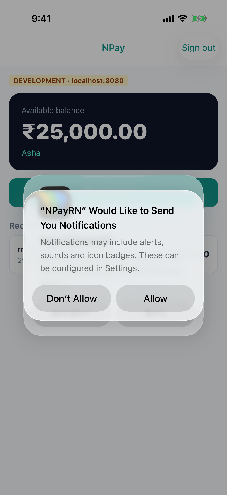
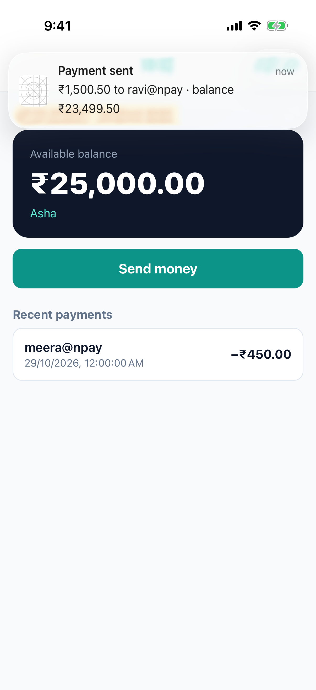
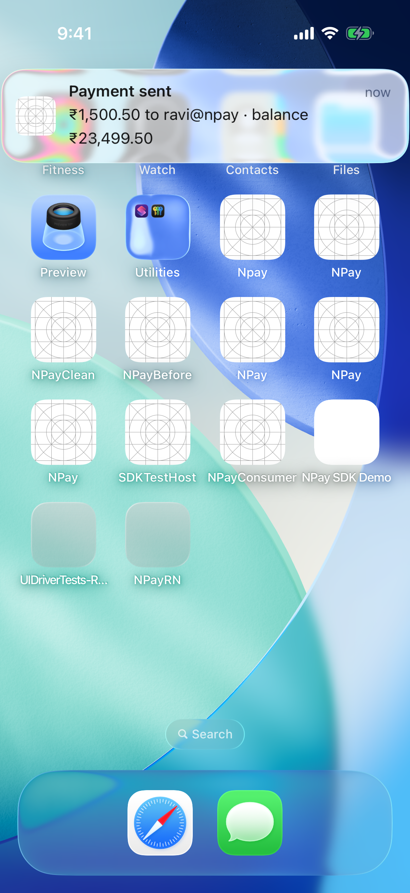
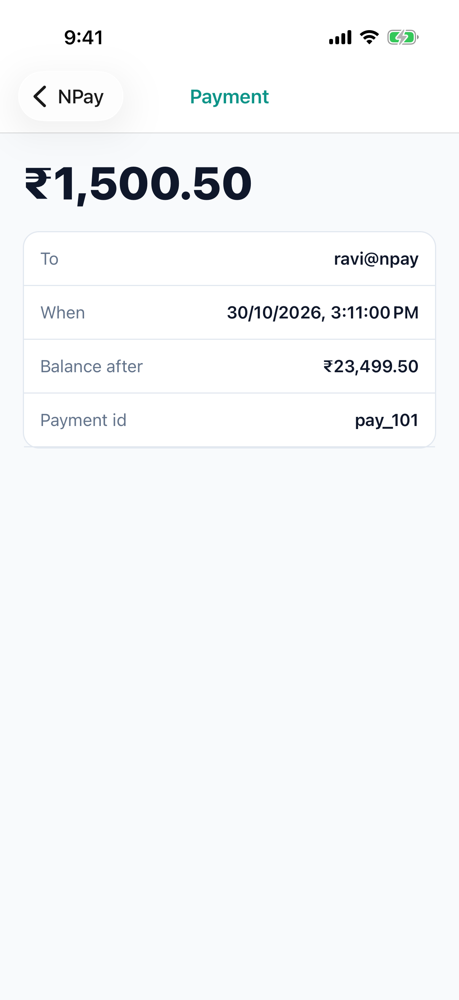
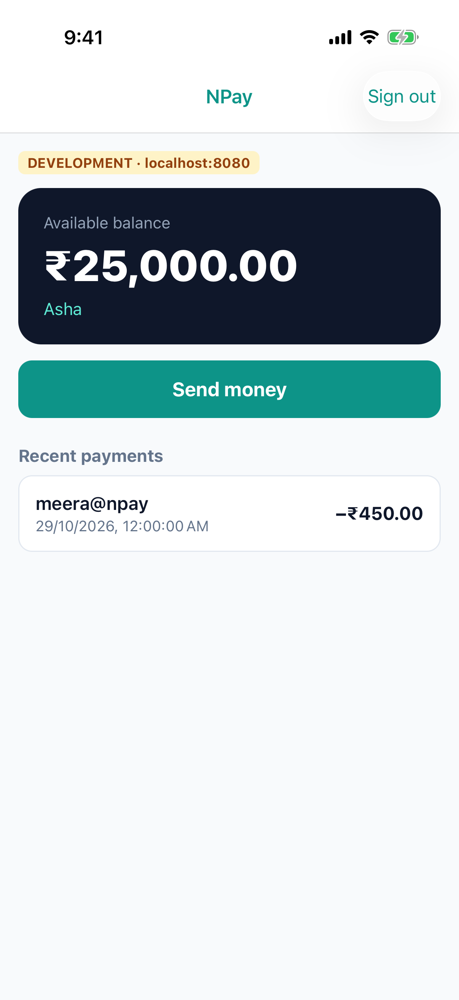
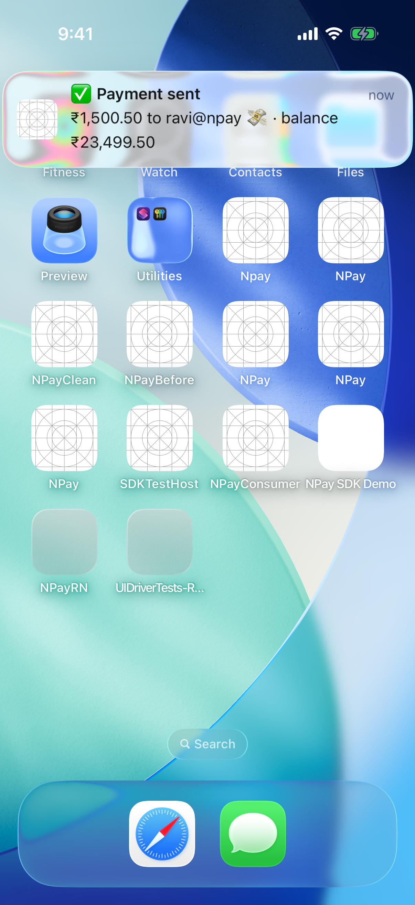

# Lab 5 · Notifications in the Simulator

**Branch:** `lab-05` (built on `lab-04`) · **Account:** none needed  
**Background:** [lab5-concepts.md](lab5-concepts.md): how push works, who sends it, how a tap picks the screen, emojis and timers

**Goal:** NPay shows a **"Payment sent"** notification, and tapping it opens that payment, whether NPay is open, in the
background, or not running at all. The notification is delivered by `xcrun simctl push`, which feeds the Simulator the
same kind of payload Apple's push service (APNs) would; Lab 6 has the NPay server send it.

| | iOS does | NPay does |
|---|---|---|
| asking permission | shows **"Would Like to Send You Notifications"** once | asks after sign-in (`requestPermission`) |
| a notification arrives, NPay **open** | asks NPay what to do | Swift says *show it as a banner anyway* |
| NPay in the **background** | shows the banner on the home screen | nothing until tapped |
| the user **taps** it | opens NPay and tells it which notification | Swift hands the payload to JS → **Payment detail** |
| NPay **not running** | launches NPay, then tells it about the tap | Swift keeps the tap until JS asks; JS opens it after sign-in |

## What changed on this branch

```sh
git diff lab-04 lab-05 --stat
```

| File | What it does |
|---|---|
| `ios/NPayRN/NotificationCenterDelegate.swift` (new) | iOS's `UNUserNotificationCenterDelegate`: **willPresent** → show a banner even while NPay is open; **didReceive** (a tap) → send the payload to JS, or keep it if JS isn't listening yet |
| `ios/NPayRN/AppDelegate.swift` | sets that delegate **at launch**, so the tap that launched the app isn't lost |
| `ios/NPayRN/NPayNotifications.swift` + `.m` (new) | the native module: `requestPermission()`, `getPermissionStatus()`, `getInitialNotification()`, and the **`notificationTapped`** event (an `RCTEventEmitter`) |
| `src/notifications.ts` (new) | the JS side of that module |
| `App.tsx` | after sign-in: ask permission; on a tap (or the launch tap): open **Payment detail**, after sign-in if needed |
| `push/payment-sent.apns` (new) | the notification, as Apple's push format, plus NPay's own `payment` data |

### The payload: `NPayRN/push/payment-sent.apns`

```json
{
  "Simulator Target Bundle": "com.npay.workshop",
  "aps": {
    "alert": { "title": "Payment sent", "body": "₹1,500.50 to ravi@npay · balance ₹23,499.50" },
    "sound": "default"
  },
  "payment": { "id": "pay_101", "recipient": "ravi@npay", "amount_paise": 150050,
               "balance_after_paise": 2349950, "created_at": "2026-10-30T09:41:00Z" }
}
```

- **`aps`** is Apple's part: what iOS shows (title, body, sound). Same format a real push uses.
- **`payment`** is NPay's own data. iOS ignores it and passes it to the app on a tap; NPay opens that payment.
- **`Simulator Target Bundle`** is for `simctl` only: which app the notification is for.
- Limit: **4096 bytes** (this one is 386).

### The path of a tap

```
tap ──▶ iOS ──▶ NotificationCenterDelegate.didReceive (Swift)
                  ├─ JS listening ──▶ NPayNotifications sends "notificationTapped" ──▶ App.tsx ──▶ Payment detail
                  └─ JS not ready ──▶ keeps it ──▶ App.tsx calls getInitialNotification() at start ──▶ Payment detail
```

---

## Run it

```sh
cd ~/npay-workshop && git checkout lab-05
cd NPayRN/ios && bundle exec pod install          # only if you switched branches
```

Terminal 1, the server: `cd ~/npay-workshop/server && ./mvnw spring-boot:run`
Terminal 2, Metro: `cd ~/npay-workshop/NPayRN && npx react-native start`
Terminal 3:

```sh
cd ~/npay-workshop/NPayRN/ios
xcodebuild -workspace NPayRN.xcworkspace -scheme NPayRN -configuration Debug \
  -sdk iphonesimulator -destination 'platform=iOS Simulator,name=iPhone 17 Pro' \
  -derivedDataPath build build 2>&1 | grep -E "error:|BUILD (SUCCEEDED|FAILED)"
xcrun simctl uninstall "iPhone 17 Pro" com.npay.workshop      # fresh install: iOS forgets the permission answer
xcrun simctl install "iPhone 17 Pro" build/Build/Products/Debug-iphonesimulator/NPayRN.app
xcrun simctl launch "iPhone 17 Pro" com.npay.workshop
```

## 1 · Permission

Sign in (**asha / npay-demo**). iOS asks:

> **"NPayRN" Would Like to Send You Notifications** · Don't Allow · **Allow**

Tap **Allow**. (The name is the app's display name, `NPayRN`.) iOS may also offer **Save Password?**: tap **Not Now**.
Asking is a one-time event: iOS remembers the answer until the app is deleted (or changed in Settings › Notifications).



## 2 · A notification while NPay is open

Stay on Home and, in terminal 3:

```sh
cd ~/npay-workshop/NPayRN
xcrun simctl push "iPhone 17 Pro" com.npay.workshop push/payment-sent.apns
# Notification sent to 'com.npay.workshop'
```

A **"Payment sent"** banner appears **over NPay**. By default iOS hides notifications for the app you're in;
`willPresent` in `NotificationCenterDelegate.swift` asks for `[.banner, .list, .sound]` instead. Tap it: **Payment
detail** opens: ₹1,500.50 to ravi@npay, balance after ₹23,499.50, pay_101.

| banner over NPay | after the tap |
|---|---|
|  |  |

## 3 · In the background

Go to the home screen (**⇧⌘H** in the Simulator), push again, tap the banner: NPay comes back **on that payment**.

| banner on the home screen | after the tap |
|---|---|
|  |  |

## 4 · NPay not running

```sh
xcrun simctl terminate "iPhone 17 Pro" com.npay.workshop
xcrun simctl push "iPhone 17 Pro" com.npay.workshop push/payment-sent.apns
```

Tap the banner. NPay **launches**; JS isn't running yet, so Swift keeps the tap (`pendingTap`). NPay starts at sign-in;
sign in and **Payment detail** opens by itself: `App.tsx` picked the tap up with `getInitialNotification()` and waited
for the sign-in.



## 5 · Try it: Don't Allow

Delete and reinstall the app (the `uninstall` / `install` lines above), sign in, tap **Don't Allow**, then push again.
`simctl` still prints *Notification sent*, but **nothing appears** (checked for 15 seconds): iOS drops notifications
from an app the user said no to. Settings › Notifications › NPayRN lets the user change it later; the app cannot
show the prompt again.



## 6 · Try it: emojis

A notification's title and body are plain text, so emojis are just characters in the payload; nothing changes in
the app. `push/payment-sent-emoji.apns` is the same notification with:

```json
"title": "✅ Payment sent",
"body": "₹1,500.50 to ravi@npay 💸 · balance ₹23,499.50"
```

```sh
xcrun simctl push "iPhone 17 Pro" com.npay.workshop push/payment-sent-emoji.apns
```

Keep payload files **UTF-8** (`₹` needs it too). Emojis count toward the 4096-byte limit: usually 4 bytes each
(this file is 395 bytes).



**And timers?** A notification's text is fixed when it is sent: it cannot count down. Lab 6 adds a notification the
app **schedules** for later (a reminder), and Lab 8 a **Live Activity** whose countdown keeps running on the lock
screen.

## How these screenshots were made

`sh scripts/lab05-run.sh` runs steps 1–4 with **real taps**: an XCUITest driver (`scripts/uidriver/`) types the
password, taps **Allow** and the banners, while the script sends `xcrun simctl push` whenever the driver is ready. All
three cases passed (`** TEST SUCCEEDED **`), and on a fresh install the **Don't Allow** case (step 5) passed too.

## Checklist

| Check | Pass when |
|---|---|
| permission | the prompt appears once after sign-in |
| open | a banner shows over NPay; the tap opens Payment detail |
| background | the banner on the home screen; the tap returns to that payment |
| not running | the tap launches NPay; after sign-in, Payment detail opens |
| `simctl push` | prints `Notification sent to 'com.npay.workshop'` |

## Answer before Lab 6

1. Which part of the payload does iOS read, and which part does NPay read?
2. Why is the delegate set in `AppDelegate` at launch, and not later from JavaScript?
3. Without `willPresent`, what would the user see when a notification arrives while NPay is open?
4. What does `getInitialNotification()` solve?
5. `xcrun simctl push` stands in for Apple's push service. What would a real server need to send a push to a real
   iPhone? (Lab 6, and Lab 4's answer about Push with a free Apple ID.)

## If something goes wrong

| You see | Do this |
|---|---|
| no permission prompt | the app was already asked: `xcrun simctl uninstall …` and install again |
| `simctl push` succeeds but nothing appears | you tapped Don't Allow: reinstall; or the payload's bundle id doesn't match `com.npay.workshop` |
| `Invalid JSON` / payload rejected | the `.apns` file must be valid JSON with an `aps` key, under 4096 bytes |
| the tap opens Home, not the payment | the payload has no `payment` object, or the app is from an older branch: rebuild |
| a tap while signed out seems to do nothing | expected: the payment opens right after you sign in |
