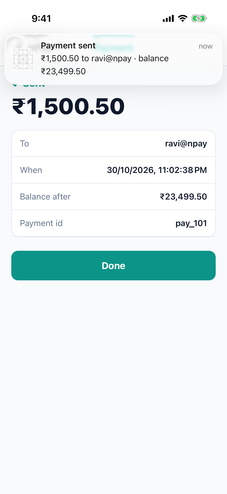
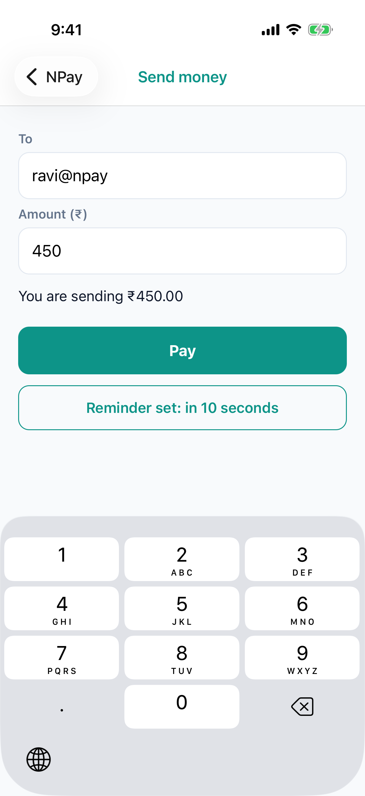
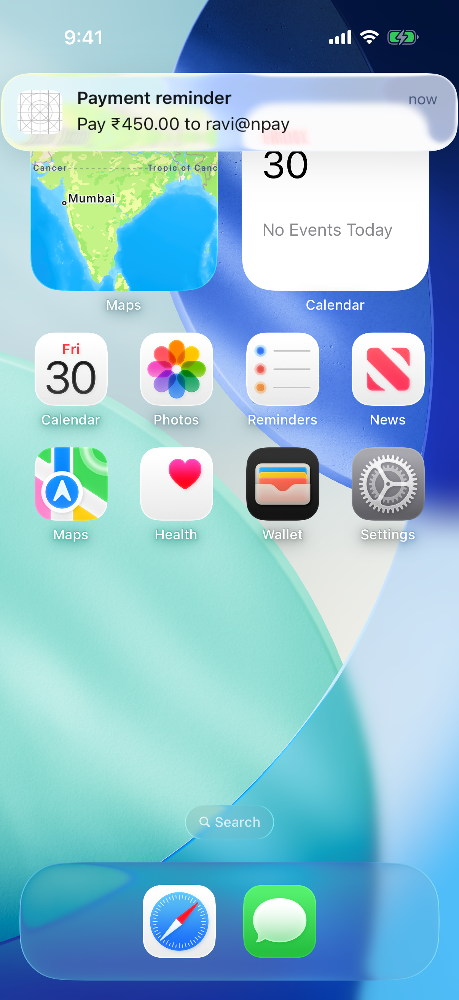
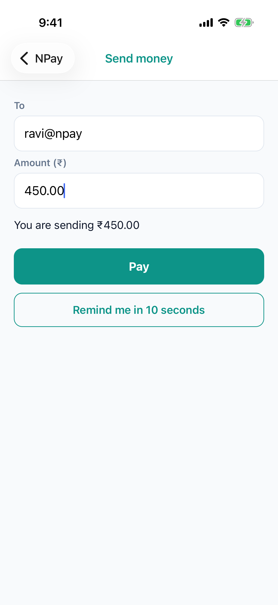

# Lab 6 · Who sends a notification: the server, or the app itself

**Branch:** `lab-06` (built on `lab-05`) · **Account:** a free Apple ID (no APNs; see "With a paid account")

**Goal:** two new senders for the notifications Lab 5 taught NPay to show and open:

| | Sender | When | Delivered by | Tap opens |
|---|---|---|---|---|
| **A · Payment sent** | the **NPay server** (Spring Boot) | right after a real payment | `xcrun simctl push` on the Mac (stands in for APNs) | Payment detail |
| **B · Payment reminder** | the **app itself** (a *local* notification) | 10 seconds after "Remind me" | iOS, on the phone: no server at all | Send money, **pre-filled** |

Lab 5's app code (`willPresent`, `didReceive`, the `notificationTapped` event) handles both without change; only
*who sends* is new.

## What changed on this branch

```sh
git diff lab-05 lab-06 --stat
```

| File | What it does |
|---|---|
| `server/…/PushNotifier.java` (new) | after a payment, builds "Payment sent" **from that payment** and delivers it; announces each payment id **once** |
| `server/…/Money.java` (new) | paise → "₹1,500.50" for the notification text (the app's `money.ts`, in Java) |
| `server/…/PaymentController.java` | calls `notifier.paymentSent(payment)` after a successful `POST /v1/payments` |
| `server/…/AdminController.java` | `/admin/reset` also clears the notifier's memory (ids restart at `pay_101`) |
| `server/…/application.properties` | `npay.push.simulator=true` (set `false` to turn server pushes off) |
| `ios/NPayRN/NPayNotifications.swift` + `.m` | new method **`scheduleReminder(seconds, title, body, data)`**: a local notification |
| `src/notifications.ts`, `src/navigation.ts` | `scheduleReminder()`; Send money can take `{ recipient, amountPaise }` |
| `src/screens/SendScreen.tsx` | **"Remind me in 10 seconds"**; fills the form from a reminder, even if the screen is already open |
| `App.tsx` | a tapped notification with a `reminder` opens Send money; with a `payment`, Payment detail (Lab 5) |

---

## A · The server sends "Payment sent"

### How

```
NPay app ──POST /v1/payments──▶ PaymentController ──▶ Bank.pay ──▶ 201 (the answer goes back at once)
                                        └──▶ PushNotifier.paymentSent(payment)   (in the background)
                                                 builds the payload from THIS payment
                                                 └──▶ xcrun simctl push booted com.npay.workshop -  ──▶ Simulator
```

The payload is the one from Lab 5, now filled in by the server with the real payment:

```java
{"aps":{"alert":{"title":"Payment sent","body":"%s to %s · balance %s"},"sound":"default"},
 "payment":{"id":"%s","recipient":"%s","amount_paise":%d,"balance_after_paise":%d,"created_at":"%s"}}
```

- **In the background** (`CompletableFuture.runAsync`): the payment's HTTP answer never waits for the notification.
- **Once per payment:** a retried request with the same Idempotency-Key returns the same payment, and must not
  notify twice.
- **`xcrun simctl push … -`** reads the payload from standard input; `booted` means the running Simulator. This works
  because the server runs on the same Mac as the Simulator.

### Run it

```sh
cd ~/npay-workshop && git checkout lab-06
cd NPayRN/ios && bundle exec pod install          # only if you switched branches
```

**Terminal 1, the server** (stop any older server first with Ctrl-C: it must be the **lab-06** one, with
`PushNotifier`):

```sh
cd ~/npay-workshop/server && ./mvnw spring-boot:run
```

**Terminal 2, Metro:**

```sh
cd ~/npay-workshop/NPayRN && npx react-native start
```

**Terminal 3, build, install and launch the app** (rebuild: Lab 6 adds Swift code):

```sh
cd ~/npay-workshop/NPayRN/ios
xcodebuild -workspace NPayRN.xcworkspace -scheme NPayRN -configuration Debug \
  -sdk iphonesimulator -destination 'platform=iOS Simulator,name=iPhone 17 Pro' \
  -derivedDataPath build build 2>&1 | grep -E "error:|BUILD (SUCCEEDED|FAILED)"
xcrun simctl boot "iPhone 17 Pro"; open -a Simulator
xcrun simctl uninstall "iPhone 17 Pro" com.npay.workshop      # fresh install: iOS asks for permission again
xcrun simctl install "iPhone 17 Pro" build/Build/Products/Debug-iphonesimulator/NPayRN.app
xcrun simctl launch "iPhone 17 Pro" com.npay.workshop
```

In the Simulator: sign in (**asha / npay-demo**), tap **Allow**, and **Not Now** if iOS offers to save the password.

Send **₹1,500.50** to ravi@npay. Right after **✓ Sent**, a banner arrives that **nobody typed**:

> **Payment sent** · ₹1,500.50 to ravi@npay · balance ₹23,499.50

and the server terminal shows (`evidence/06-server-log.txt`):

```
-> POST /v1/payments  Bearer at_…  Idempotency-Key: npay-179…
<- 201
   push pay_101 → Simulator: Notification sent to 'com.npay.workshop'
```



### Try it: a retry doesn't notify twice

Send the same payment request twice with the same Idempotency-Key (terminal 3):

```sh
A=$(curl -s -H 'Content-Type: application/json' -d '{"username":"asha","password":"npay-demo"}' \
    localhost:8080/v1/login | python3 -c 'import json,sys;print(json.load(sys.stdin)["access_token"])')
for i in 1 2; do
  curl -s -H "Authorization: Bearer $A" -H 'Content-Type: application/json' -H 'Idempotency-Key: retry-demo-1' \
    -d '{"recipient":"ravi@npay","amount_paise":150050}' localhost:8080/v1/payments; echo
done
```

Expect (`evidence/06-retry-one-push.txt`): both answers are **the same payment** (`pay_101`), the log shows two
`POST`s and **one** `push pay_101` line, and one banner appears.

---

## B · The app schedules a reminder

### How

```swift
// NPayNotifications.swift · scheduleReminder
let content = UNMutableNotificationContent()
content.title = title                     // "Payment reminder"
content.body = body                       // "Pay ₹450.00 to ravi@npay"
content.userInfo = data                   // { "reminder": { "recipient": …, "amount_paise": 45000 } }
let trigger = UNTimeIntervalNotificationTrigger(timeInterval: seconds, repeats: false)
UNUserNotificationCenter.current().add(UNNotificationRequest(identifier: …, content: content, trigger: trigger))
```

The app hands iOS the whole notification and a **trigger**; iOS shows it at that time, even if NPay is in the
background or not running. No server, no APNs, no Apple account. On a tap, Lab 5's `didReceive` passes the
`reminder` data to JS, and `App.tsx` opens **Send money** with it.

### Run it

1. Home › **Send money**, amount **450**, tap **Remind me in 10 seconds** → the button says *Reminder set*.
2. Go to the home screen (**⇧⌘H**) and wait about 10 seconds:
   > **Payment reminder** · Pay ₹450.00 to ravi@npay
3. Tap it: NPay opens **Send money** with ravi@npay and **450.00** filled in.

| reminder set | 10 s later | after the tap |
|---|---|---|
|  |  |  |

**Found while building this lab:** Send money was still open underneath when the reminder was tapped, and React
Navigation **reused** it with its old typed text ("450", not "450.00"). `SendScreen.tsx` now refills the form whenever
it receives new params. Any screen a notification can open needs the same care.

### Other triggers (reference; not run in this lab)

| Trigger | Fires | Example |
|---|---|---|
| `UNTimeIntervalNotificationTrigger(timeInterval: 10, repeats: false)` | after N seconds (used above) | "remind me in 1 hour" |
| `UNCalendarNotificationTrigger(dateMatching: DateComponents(hour: 9, minute: 0), repeats: true)` | at a date/time, optionally repeating | "every day at 9:00: check your balance" |
| `UNLocationNotificationTrigger(region: …)` | entering/leaving a place | (needs location permission) |

A repeating time-interval trigger must be at least 60 seconds. Scheduled notifications can be listed and cancelled
(`getPendingNotificationRequests`, `removePendingNotificationRequests(withIdentifiers:)`).

---

## With a paid account: real APNs (explained; not run with a free Apple ID)

Only **delivery** changes; the app's display and tap handling stay as they are.

| Step | Free Apple ID (this lab) | Paid account |
|---|---|---|
| app registers for pushes | not needed | `UIApplication.shared.registerForRemoteNotifications()` → iOS returns a **device token** (`didRegisterForRemoteNotificationsWithDeviceToken`) |
| app → server | not needed | the app sends the device token to the server (e.g. `POST /v1/devices`), stored with Asha's account |
| server → phone | `xcrun simctl push booted …` | an HTTP/2 `POST` to `https://api.sandbox.push.apple.com/3/device/<device token>` (sandbox = development builds; `api.push.apple.com` for TestFlight/App Store) with headers `apns-topic: com.npay.workshop`, `apns-push-type: alert`, and `authorization: bearer <JWT>` signed with the team's **`.p8` key** |
| the payload | the same JSON | the same JSON |

In `PushNotifier.java`, only `deliver()` would change. Lab 4 showed why it can't run here: a free team doesn't get the
Push capability, and the `.p8` key comes from the paid developer portal.

## How these screenshots were made

`sh scripts/lab06-run.sh` (with the lab-06 server and Metro running): the UI driver signs in, taps Allow, types the
amount, taps Pay and Remind me, goes to the home screen and taps the banners. Both tests passed, twice in a row
(`evidence/06-uidriver-tests.txt`).

## Checklist

| Check | Pass when |
|---|---|
| server push | after Pay, a "Payment sent" banner arrives with that payment's amount and balance |
| server log | `push pay_… → Simulator: Notification sent to 'com.npay.workshop'` |
| retry | the same Idempotency-Key twice → one payment, one push |
| reminder | "Payment reminder" about 10 s after "Remind me", even on the home screen |
| reminder tap | Send money opens with the recipient and amount filled in |

## Answer before Lab 7

1. What is the difference between a **remote** notification (A) and a **local** one (B)? Which needs a server?
2. Why does the server send the notification in the background, not before answering the payment?
3. Why must the server remember which payments it announced? What would a retry do otherwise?
4. In the paid setup, what does the server need that it doesn't need here?
5. Why did a reminder tapped while Send money was open show stale text, and what fixed it?

## If something goes wrong

| You see | Do this |
|---|---|
| tapping **Remind me** shows a red *Console Error: Uncaught (in promise) "TypeError: undefined is not a function"* | the JS is from lab-06 but the installed app was built **before** you switched branches, so its Swift has no `scheduleReminder`: rebuild and reinstall (terminal 3). JS changes come from Metro instantly; native changes need a rebuild |
| no banner after Pay | is the **lab-06** server running (its log prints `push …`)? did you tap **Allow**? |
| server log: `push … failed` or no `push` line | the server must run on the Mac with the Simulator **booted**; `npay.push.simulator=true` |
| `push … → Simulator: An error was encountered … Invalid device: booted` | no Simulator is running: boot one |
| no reminder | permission denied, or NPay was reinstalled after scheduling (deleting the app removes its scheduled notifications) |
| the reminder opens Send money with old text | the app is older than lab-06: reload the JS (⌘R) |
