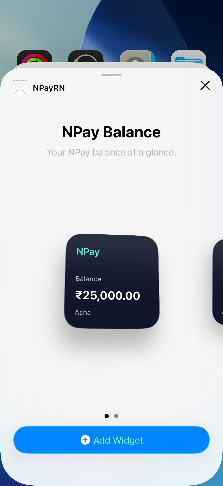
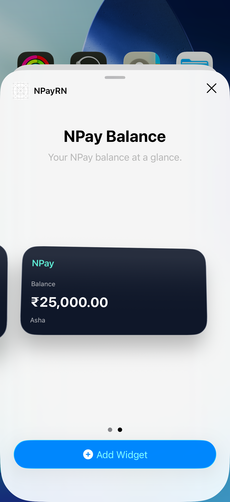
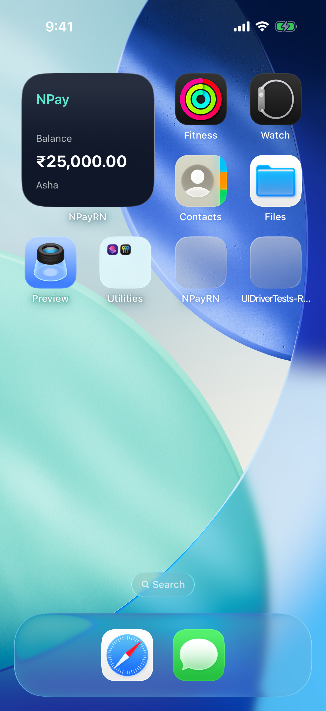
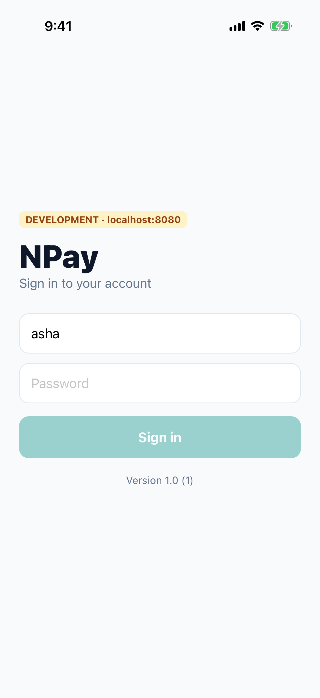

# Lab 7 · A home-screen widget, in SwiftUI

**Branch:** `lab-07` (built on `lab-06`) · **Account:** none needed

**Goal:** add a **widget** to the React Native app: NPay's balance on the home screen. A widget is native: there is no
React Native widget. It is a **SwiftUI** view inside a separate **app extension**, shipped inside the app. This lab
shows sample data; Lab 8 makes it show Asha's real balance.

## What a widget is

```
NPayRN.app                       ← your app (React Native + Swift)
└── PlugIns/
    └── NPayWidget.appex         ← the widget extension: its own small program, its own bundle id
```

- **Not part of the running app.** iOS runs the widget's code *on its own schedule*, even when NPay isn't running,
  and it cannot run JavaScript.
- **A timeline, not a live screen.** iOS asks the widget's **Provider** for *entries* (data + a date) and draws the
  SwiftUI **view** for each one. The view is drawn once and kept; it doesn't update itself.
- **Shipped inside the app.** Installing NPay installs the widget; it appears in iOS's widget gallery.

| Piece | In `ios/NPayWidget/NPayWidget.swift` | What it does |
|---|---|---|
| **Entry** | `BalanceEntry` (date, owner, balancePaise) | one moment of data |
| **Provider** | `placeholder` · `getSnapshot` · `getTimeline` | gives iOS entries: while loading, in the gallery, on the home screen |
| **View** | `NPayWidgetView` (SwiftUI) | draws one entry, small or medium |
| **Widget** | `@main struct NPayWidget: Widget` | its name, description, sizes, and `kind` (`"NPayBalance"`) |

## What changed on this branch

```sh
git diff lab-06 lab-07 --stat
```

| File | What it does |
|---|---|
| `ios/NPayWidget/NPayWidget.swift` (new) | the widget: entry, provider, SwiftUI view, configuration, a `#Preview` |
| `ios/NPayWidget/Info.plist` (new) | `NSExtensionPointIdentifier = com.apple.widgetkit-extension`: "this is a widget"; display name **NPay** |
| `ios/NPayRN.xcodeproj/project.pbxproj` | a new target **NPayWidget** (an app extension, iOS 17+, bundle id `com.npay.workshop.NPayWidget`, Debug/Staging/Release); the app **depends on** it and **embeds** it ("Embed Foundation Extensions" → `PlugIns/`) |

No JavaScript and no Podfile change: the widget is pure Swift and uses no pods.

### The code, in short

```swift
struct Provider: TimelineProvider {
  func placeholder(in context: Context) -> BalanceEntry { .sample }        // while loading (greyed)
  func getSnapshot(in context: Context, completion: …) { completion(.sample) }   // in the gallery
  func getTimeline(in context: Context, completion: …) {                    // on the home screen
    completion(Timeline(entries: [.sample], policy: .never))               // .never: until the app asks (Lab 8)
  }
}

struct NPayWidgetView: View {                // plain SwiftUI, like your last four days
  let entry: BalanceEntry
  var body: some View {
    VStack(alignment: .leading) {
      Text("NPay").font(.headline)
      Spacer()
      Text("Balance").font(.caption)
      Text(formatPaise(entry.balancePaise)).font(.title).bold()       // ₹25,000.00
      Text(entry.owner).font(.caption)
    }
    .containerBackground(Color(red: 0.06, green: 0.09, blue: 0.16), for: .widget)   // required since iOS 17
  }
}

@main
struct NPayWidget: Widget {
  var body: some WidgetConfiguration {
    StaticConfiguration(kind: "NPayBalance", provider: Provider()) { NPayWidgetView(entry: $0) }
      .configurationDisplayName("NPay Balance")
      .description("Your NPay balance at a glance.")
      .supportedFamilies([.systemSmall, .systemMedium])
  }
}
```

### Doing it in Xcode by hand (what the branch did with a script)

1. **File › New › Target… › Widget Extension**, name `NPayWidget`, untick "Include Live Activity" and "Include
   Configuration App Intent" (Lab 8 adds a Live Activity) → **Finish** (and **Activate** the scheme if asked).
2. Xcode creates the target, its `Info.plist` and a sample widget file, and embeds it in the app. Replace the sample
   with `NPayWidget.swift`.
3. Set the extension's **Minimum Deployment** to iOS 17 (for `containerBackground`).

---

## Run it

```sh
cd ~/npay-workshop && git checkout lab-07
cd NPayRN/ios && bundle exec pod install          # only if you switched branches
```

Start the server (terminal 1) and Metro (terminal 2) as in Lab 6, then terminal 3:

```sh
cd ~/npay-workshop/NPayRN/ios
xcodebuild -workspace NPayRN.xcworkspace -scheme NPayRN -configuration Debug \
  -sdk iphonesimulator -destination 'platform=iOS Simulator,name=iPhone 17 Pro' \
  -derivedDataPath build build 2>&1 | grep -E "error:|BUILD (SUCCEEDED|FAILED)"
xcrun simctl boot "iPhone 17 Pro"; open -a Simulator    # "current state: Booted" is fine
xcrun simctl install "iPhone 17 Pro" build/Build/Products/Debug-iphonesimulator/NPayRN.app
xcrun simctl launch "iPhone 17 Pro" com.npay.workshop
```

Launch NPay once: iOS lists an app's widgets after the app has run.

## 1 · Look inside the app

```sh
ls build/Build/Products/Debug-iphonesimulator/NPayRN.app/PlugIns
plutil -p build/Build/Products/Debug-iphonesimulator/NPayRN.app/PlugIns/NPayWidget.appex/Info.plist \
  | grep -E "CFBundleIdentifier|CFBundleDisplayName|NSExtensionPointIdentifier"
```

Expect (`evidence/07-inside-app.txt`):

```
NPayWidget.appex
  "CFBundleDisplayName" => "NPay"
  "CFBundleIdentifier" => "com.npay.workshop.NPayWidget"
    "NSExtensionPointIdentifier" => "com.apple.widgetkit-extension"
```

The widget is a separate bundle **inside** the app, with its own bundle id (the app's id + `.NPayWidget`).

## 2 · Add the widget to the home screen

In the Simulator:

1. Go to the home screen (**⇧⌘H**). **Long-press an empty spot** until the icons jiggle.
2. Tap **Edit** (top left) › **Add Widget**.
3. In **Search Widgets**, type **NPay** › tap **NPayRN**.
4. **NPay Balance · Your NPay balance at a glance.** Swipe for the medium size. Tap **Add Widget**, then **Done**.

| the gallery (small) | the gallery (medium) | on the home screen |
|---|---|---|
|  |  |  |

The gallery and the home screen show **₹25,000.00 · Asha**: that is `BalanceEntry.sample`, from `getSnapshot` and
`getTimeline`. It is **sample data**: pay something in NPay and the widget still says ₹25,000.00. Lab 8 fixes that.

## 3 · Tap it

Tap the widget: **NPay opens** (by default a widget tap opens its app). Lab 8 sends it to a specific screen.



## 4 · The Staging and Release builds

The widget target has the same three configurations as the app, so every build embeds it:

```sh
for cfg in Staging Release; do
  xcodebuild -workspace NPayRN.xcworkspace -scheme NPayRN -configuration $cfg \
    -sdk iphonesimulator -destination 'platform=iOS Simulator,name=iPhone 17 Pro' \
    -derivedDataPath build build 2>&1 | grep -E "error:|BUILD (SUCCEEDED|FAILED)"
  ls build/Build/Products/$cfg-iphonesimulator/NPayRN.app/PlugIns
done
```

Expect `** BUILD SUCCEEDED **` and `NPayWidget.appex` for both.

## How these screenshots were made

`sh scripts/lab07-run.sh` uses the UI driver to do step 2 and 3 with real taps on SpringBoard (long-press, Edit, Add
Widget, search, Add Widget, Done, tap). It **erases the Simulator first** for a clean home screen. Passed
(`evidence/07-uidriver-tests.txt`).

## Checklist

| Check | Pass when |
|---|---|
| build | `** BUILD SUCCEEDED **`; `NPayRN.app/PlugIns/NPayWidget.appex` exists |
| extension | its Info.plist says `com.apple.widgetkit-extension`, bundle id `com.npay.workshop.NPayWidget` |
| gallery | searching "NPay" shows **NPay Balance**, small and medium |
| home screen | the widget shows ₹25,000.00 · Asha |
| tap | NPay opens |

## Answer before Lab 8

1. Why can't a React Native app's widget be written in React Native?
2. What are the entry, the provider and the view, and who calls the provider?
3. The widget shows ₹25,000.00 after you paid ₹1,500.50. Why?
4. The widget is a separate program with its own bundle id. How could it read NPay's balance? (Lab 4 added an App
   Group: `group.com.npay.workshop`.)
5. What does `policy: .never` mean, and who would tell the widget to refresh?

## If something goes wrong

| You see | Do this |
|---|---|
| `Unable to lookup in current state: Shutdown` | the Simulator is off (`lab07-run.sh` erases and restarts it): `xcrun simctl boot "iPhone 17 Pro"; open -a Simulator` |
| NPay isn't in the widget gallery | launch NPay once after installing; or the installed app is older than lab-07: rebuild and reinstall |
| `NPayWidget.appex` missing from `PlugIns` | the app target must depend on and embed the widget (Build Phases › Embed Foundation Extensions) |
| `'containerBackground(_:for:)' is only available in iOS 17.0 or newer` | the widget target's Minimum Deployment must be iOS 17 |
| the widget shows the old look after a change | remove it from the home screen and add it again (iOS caches widget views) |
| tapping the widget shows the red "No script URL provided" | Metro isn't running (Debug build) |
