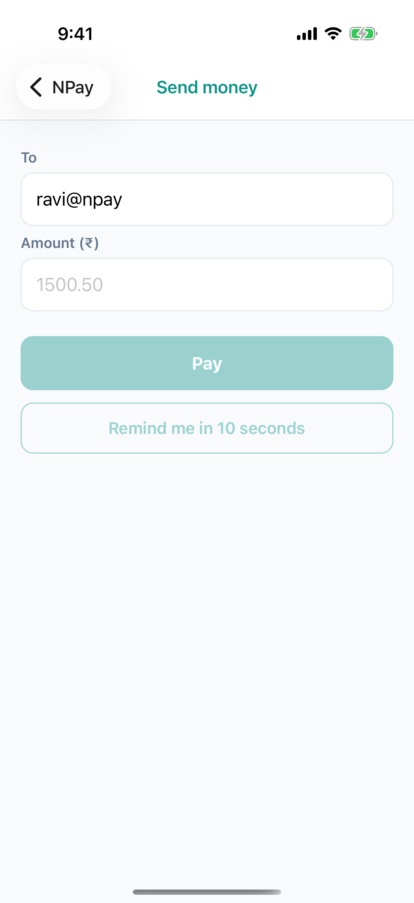
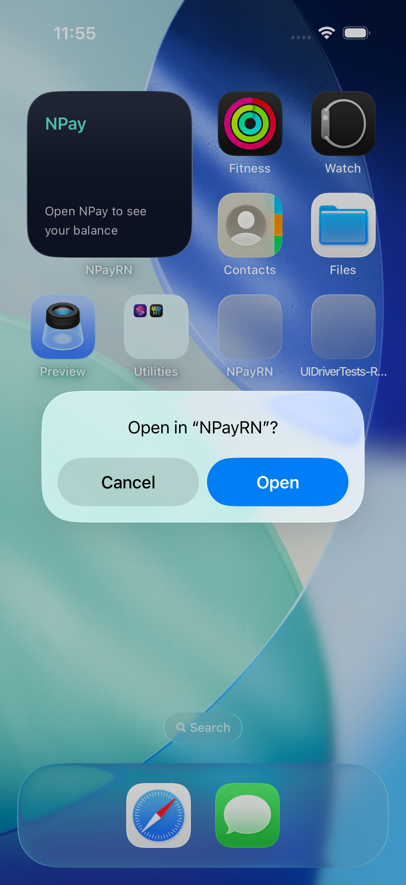
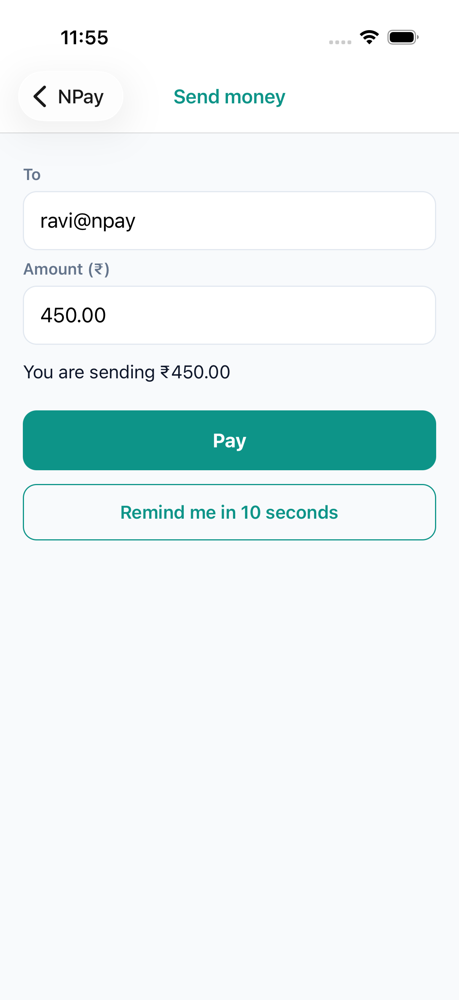
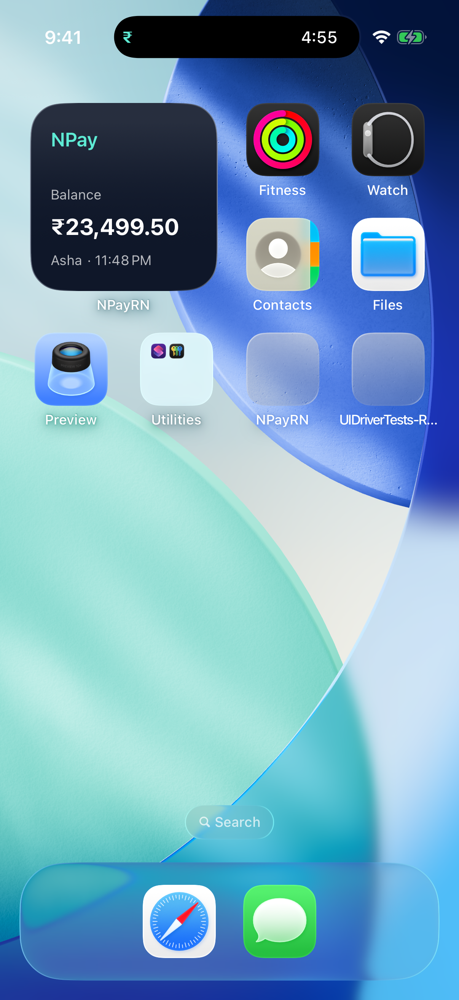
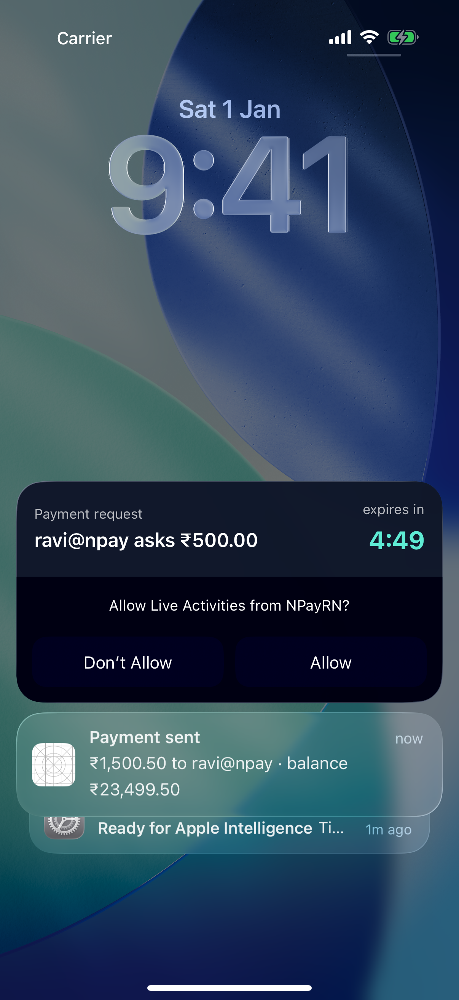
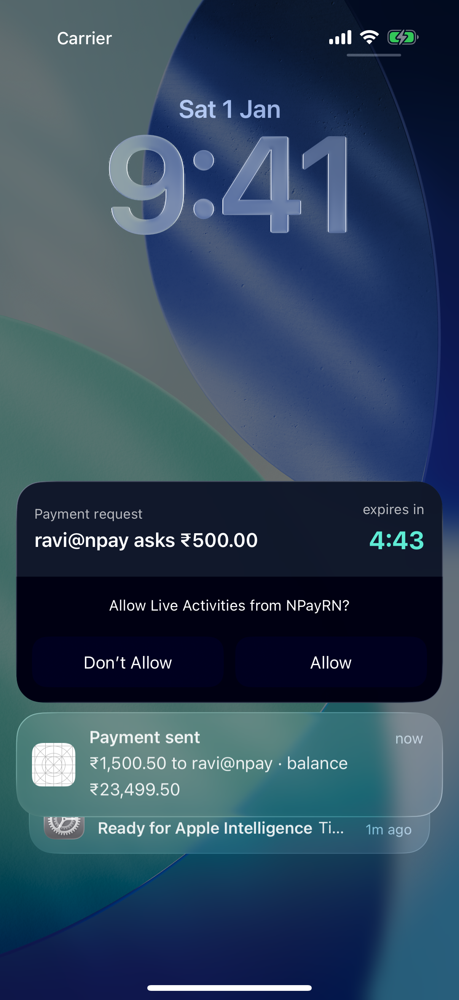
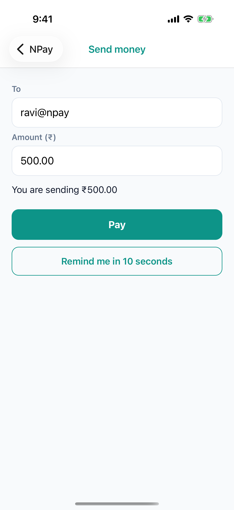
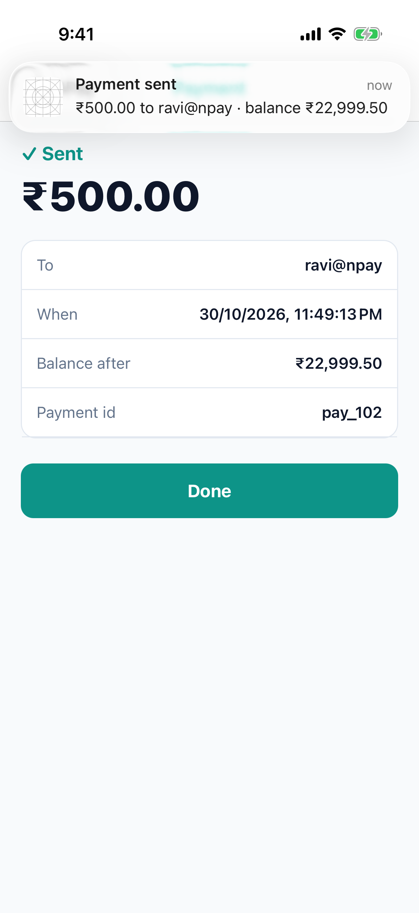
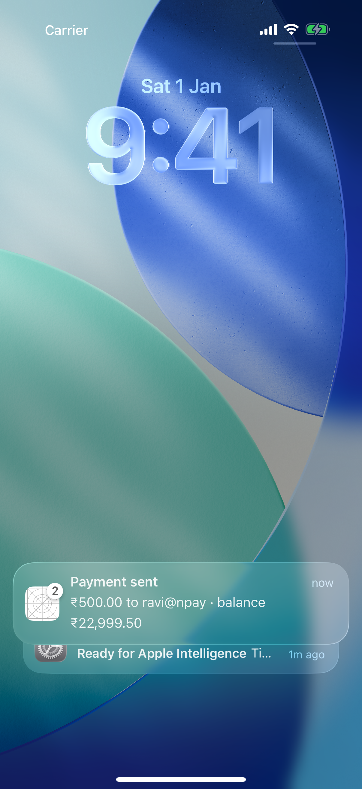
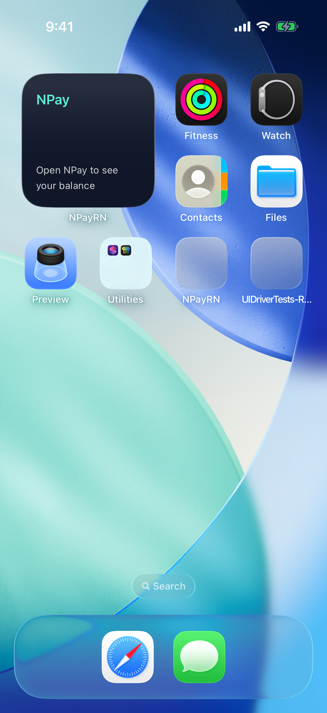

# Lab 8 · A live widget, deep links, and a Live Activity countdown

**Branch:** `lab-08` (built on `lab-07`) · **Account:** none needed (App Groups work in the Simulator)

**Goal:** fix Lab 7's problem (*the widget always says ₹25,000.00*) and add a countdown that runs by itself:

| Part | What Asha sees | How |
|---|---|---|
| **A · Live widget** | the widget shows her **real** balance, and **₹23,499.50** right after paying ₹1,500.50 | the app writes the balance into the **App Group** and asks iOS to **reload** the widget |
| **B · Deep link** | tapping the widget opens **Send money** | the widget opens the URL `npay://send`; React Native's `Linking` routes it |
| **C · Live Activity** | *"ravi@npay asks ₹500.00 · expires in 4:59"* on the lock screen and in the Dynamic Island, **counting down by itself**; tap → Send money pre-filled; paying ends it | ActivityKit + a SwiftUI view in the widget extension |
| **D · Sign-out** | the widget says *"Open NPay to see your balance"*; the countdown ends | the app clears the App Group and ends the activity |

## The idea: an App Group

```
 NPay (JS)  ── Home loads the balance ──▶ NPayWidgetBridge.updateBalance (Swift, in the app)
                                              │ writes owner, balancePaise, updatedAt
                                              ▼
                      UserDefaults(suiteName: "group.com.npay.workshop")   ← storage BOTH may read (the App Group)
                                              ▲                         WidgetCenter.reloadTimelines("NPayBalance")
                                              │ reads                              │
 NPayWidget.appex  ◀── getTimeline ──── BalanceEntry.shared() ◀── iOS asks again ──┘
```

The widget is a separate program with its own sandbox: it cannot read NPay's memory or files. An **App Group** is a
shared container both are allowed into, because both carry the same `com.apple.security.application-groups`
entitlement (`group.com.npay.workshop`): the app since Lab 4, the widget since this lab.

## What changed on this branch

```sh
git diff lab-07 lab-08 --stat
```

| File | What it does |
|---|---|
| `ios/NPayRN/NPayWidgetBridge.swift` + `.m` (new) | native module: `updateBalance(owner, balancePaise)` (write + reload), `clear()`, `startPaymentRequest(from, amountPaise, seconds)`, `endPaymentRequests()` |
| `ios/NPayWidget/NPayWidget.swift` | `BalanceEntry.shared()` reads the App Group; a signed-out view; `.widgetURL("npay://send")`; the Live Activity's SwiftUI (lock screen + Dynamic Island); a `WidgetBundle` with both |
| `ios/NPayWidget/PaymentRequestAttributes.swift` (new) | what a payment-request activity carries; compiled into **both** targets so they share the type |
| `ios/NPayWidget/NPayWidget.entitlements` (new) | the widget joins the App Group |
| `ios/NPayRN/Info.plist` | the URL scheme **`npay`** (`CFBundleURLTypes`); **`NSSupportsLiveActivities = YES`** |
| `ios/NPayRN/AppDelegate.swift` | `application(_:open:options:)` hands `npay://` links to React Native (`RCTLinkingManager`) |
| `src/widget.ts` (new) | the JS side of the module |
| `src/screens/HomeScreen.tsx` | after loading, `updateWidget(owner, balance)`; a **Demo: ravi@npay requests ₹500 (5 min)** button |
| `src/screens/SendScreen.tsx` | after a payment, `endPaymentRequests()` |
| `App.tsx` | `Linking`: `npay://send[?to=…&amount=<paise>]` → Send money (after sign-in if needed); sign-out clears the widget and ends activities |

---

## Run it

```sh
cd ~/npay-workshop && git checkout lab-08
cd NPayRN/ios && bundle exec pod install          # only if you switched branches
```

Server (terminal 1) and Metro (terminal 2) as before. Terminal 3, **rebuild** (new Swift in the app and the widget):

```sh
cd ~/npay-workshop/NPayRN/ios
xcodebuild -workspace NPayRN.xcworkspace -scheme NPayRN -configuration Debug \
  -sdk iphonesimulator -destination 'platform=iOS Simulator,name=iPhone 17 Pro' \
  -derivedDataPath build build 2>&1 | grep -E "error:|BUILD (SUCCEEDED|FAILED)"
xcrun simctl boot "iPhone 17 Pro"; open -a Simulator    # "current state: Booted" is fine
xcrun simctl install "iPhone 17 Pro" build/Build/Products/Debug-iphonesimulator/NPayRN.app
xcrun simctl launch "iPhone 17 Pro" com.npay.workshop
```

If the widget from Lab 7 is still on the home screen, it updates by itself once NPay shares a balance. Otherwise add it
again (Lab 7, step 2).

## 1 · Look inside

```sh
A=build/Build/Products/Debug-iphonesimulator/NPayRN.app
plutil -p $A/Info.plist | grep -A4 CFBundleURLTypes ; plutil -p $A/Info.plist | grep NSSupportsLiveActivities
plutil -p build/Build/Intermediates.noindex/NPayRN.build/Debug-iphonesimulator/NPayWidget.build/NPayWidget.appex-Simulated.xcent
```

Expect (`evidence/08-inside-app.txt`): the `npay` scheme, `NSSupportsLiveActivities => true`, and the **widget's** own
entitlements with `group.com.npay.workshop`, the same group as the app.

## 2 · A · The real balance

Sign in (**asha / npay-demo**), tap **Allow**. Go to the home screen: the widget shows **₹25,000.00 · Asha · 11:43 PM**
(the time it was shared). Now pay **₹1,500.50** to ravi@npay, tap **Done** (Home reloads), and go to the home screen:
**₹23,499.50**.

| real balance | after paying ₹1,500.50 |
|---|---|
|  |  |

Home calls `updateWidget(a.owner, a.balance_paise)` every time it loads; Swift writes the App Group and calls
`WidgetCenter.shared.reloadTimelines(ofKind: "NPayBalance")`; iOS asks the provider again, which reads the new value.

## 3 · B · Tap the widget: a deep link

Tap the widget: NPay opens **Send money**.



The widget says `.widgetURL(URL(string: "npay://send"))`. iOS opens the app registered for `npay` (Info.plist), passes
the URL to `AppDelegate.application(_:open:options:)`, which hands it to React Native's `Linking`; `App.tsx` turns
`npay://send` into `navigate('Send')`. Try it without the widget:

```sh
xcrun simctl openurl "iPhone 17 Pro" "npay://send?to=ravi@npay&amount=45000"
```

A link from **outside** the app makes iOS ask first: **"Open in 'NPayRN'?"** → **Open**. If you're signed out,
sign in: the link waits, then Send money opens with ravi@npay and **450.00** (the amount is in paise in the link).

| iOS asks | after Open and sign-in |
|---|---|
|  |  |

## 4 · C · A Live Activity that counts down

On Home, tap **Demo: ravi@npay requests ₹500 (5 min)**, then go to the home screen.

- The **Dynamic Island** shows **₹** and the countdown.
- Swipe down from the top-left for the lock screen view: **Payment request · ravi@npay asks ₹500.00 · expires in 4:49**.
  The first time, iOS asks **"Allow Live Activities from NPayRN?"** (tap **Allow**; the activity shows either way).
- Wait a few seconds: **4:43**. Nobody updated it: `Text(timerInterval: now...expiresAt, countsDown: true)` is drawn
  by iOS every second.

| Dynamic Island | lock screen | 6 seconds later |
|---|---|---|
|  |  |  |

Tap the activity: **Send money**, pre-filled with ravi@npay and **500.00** (its `widgetURL` is
`npay://send?to=ravi@npay&amount=50000`). Tap **Pay**: `endPaymentRequests()` ends the activity, and the lock screen
shows only the server's "Payment sent".

| opened from the activity | paid | the activity is gone |
|---|---|---|
|  |  |  |

```swift
// the app starts it (NPayWidgetBridge.swift)
let attributes = PaymentRequestAttributes(from: "ravi@npay", amountPaise: 50000)
let content = ActivityContent(state: .init(expiresAt: Date() + 300), staleDate: Date() + 300)
try Activity.request(attributes: attributes, content: content, pushType: nil)   // nil: no push updates

// the widget extension draws it (NPayWidget.swift)
ActivityConfiguration(for: PaymentRequestAttributes.self) { context in
  … Text(timerInterval: Date.now...context.state.expiresAt, countsDown: true) …   // the lock screen
} dynamicIsland: { context in … compactTrailing: { Text(timerInterval: …) } … }
```

`pushType: nil` means only the app can update or end it. **Updating it from the server** (`pushType: .token`) goes
through APNs, which needs a paid account (Lab 4).

## 5 · D · Sign out

Home › **Sign out**, then the home screen: the widget says **"Open NPay to see your balance"**; the Dynamic Island is
empty. A widget can be seen by anyone who picks up the phone: never leave money on it after sign-out.



## How these screenshots were made

`sh scripts/lab08-run.sh` (erases the Simulator; needs the server and Metro): the UI driver signs in, adds the widget,
taps it, pays, starts the request, swipes down to the lock screen, taps the activity, pays, signs out. All three tests
passed, and so did the `simctl openurl` case (`UIDriverTests/Lab08Link`; `evidence/08-uidriver-tests.txt`).

## Checklist

| Check | Pass when |
|---|---|
| App Group | the widget's entitlements list `group.com.npay.workshop` |
| real balance | the widget shows the balance Home shows, and the new one after a payment |
| deep link | tapping the widget, or `simctl openurl … npay://send…`, opens Send money |
| Live Activity | lock screen + Dynamic Island; the countdown moves by itself |
| activity → app | tap → Send money with 500.00; paying ends the activity |
| sign-out | the widget hides the balance; the activity ends |

## Answer before Lab 9

1. Why can't the widget read NPay's balance directly, and what makes the App Group work?
2. Who decides when the widget redraws: the app, iOS, or the widget?
3. What happens, step by step, between tapping the widget and Send money appearing?
4. The countdown moves every second, but NPay isn't running. Who draws it?
5. What would you need to update a Live Activity from the server?
6. Why must sign-out clear the widget?

## If something goes wrong

| You see | Do this |
|---|---|
| the widget still shows ₹25,000.00 after paying | the app is older than lab-08: rebuild; then open Home once (it shares the balance) |
| "Open NPay to see your balance" while signed in | open Home: the balance is shared when Home loads |
| tapping the widget opens NPay but not Send money | `npay` is missing from Info.plist, or the app is older than lab-08 |
| `Live Activities are turned off for NPay` | Settings › NPayRN › Live Activities: on; or tap **Allow** when iOS asks |
| no Dynamic Island | use a Simulator with one (iPhone 17 Pro); the lock-screen view still works |
| red *undefined is not a function* on the demo button | JS from lab-08, app built earlier: rebuild and reinstall |
