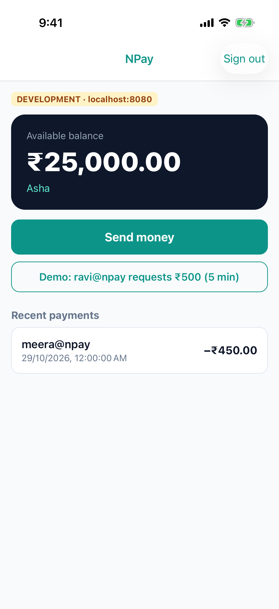
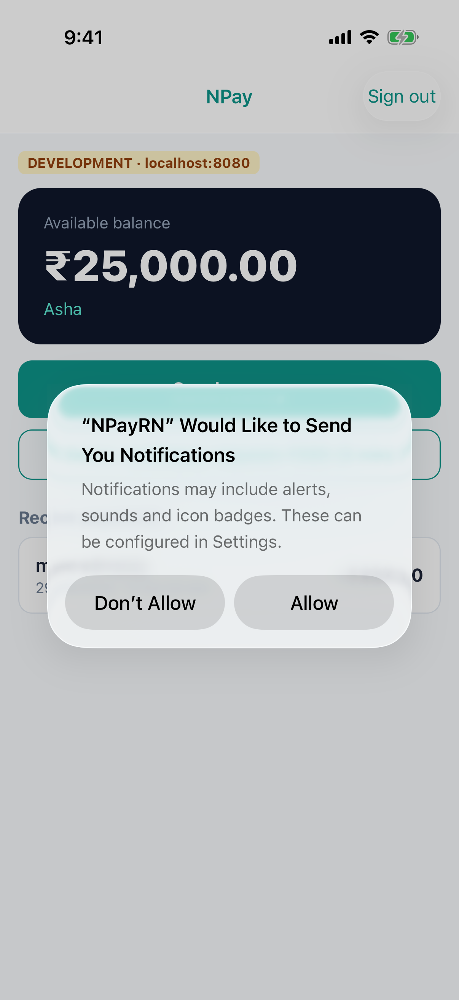
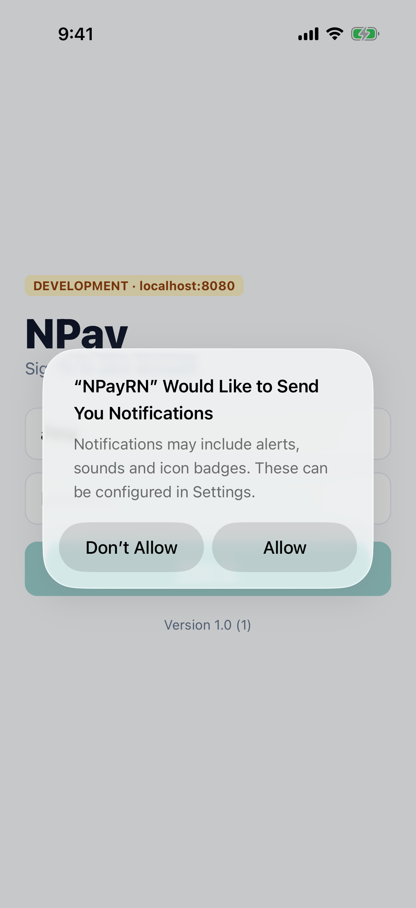

# Lab 9 · Tokens in the Keychain

**Branch:** `lab-09` (built on `lab-08`) · **Account:** none needed

**Goal:** Asha stays signed in across app launches, and the secret that makes this possible is kept **only** in the
iOS **Keychain**: not in the app's files, not in iOS's HTTP cache, not after she signs out, and not after the app is
deleted and installed again.

| Before (Labs 1–8) | After (this lab) |
|---|---|
| the token lived in JS memory: every launch asked for the password | the **refresh token** is in the Keychain; at launch NPay trades it for a new session |
| sign-out only forgot the token on the phone | sign-out also **revokes** it on the server |

## Two tokens, two places

| Token | Lives | For | Why there |
|---|---|---|---|
| **access token** | JS memory only | every API call (`Authorization: Bearer …`) | short-lived (1 hour here); gone when the app quits, which is fine |
| **refresh token** | the **Keychain** | getting a new access token at launch (`POST /v1/token`) | long-lived: must survive restarts, so it must be stored somewhere safe |

**Why not AsyncStorage (or UserDefaults, or a file)?** Those are plain files in the app's container: anyone with a
backup of the phone, or a jailbroken phone, can read them. The **Keychain** is a database iOS encrypts and keeps
outside the app's container; only NPay can read NPay's items, and with
`kSecAttrAccessibleAfterFirstUnlockThisDeviceOnly` only after the phone has been unlocked once, and never on another
device (not even from a backup).

## What changed on this branch

```sh
git diff lab-08 lab-09 --stat
```

| File | What it does |
|---|---|
| `ios/NPayRN/NPayKeychain.swift` + `.m` (new) | native module: `setItem`, `getItem`, `removeItem` (`SecItemAdd` / `SecItemCopyMatching` / `SecItemDelete`); `clearOnFreshInstall()` |
| `ios/NPayRN/AppDelegate.swift` | calls `NPayKeychain.clearOnFreshInstall()` at launch, before any JS |
| `src/api.ts` | `signIn` stores the refresh token; **`restoreSession()`** trades it for a session at launch; `signOut` revokes it (`POST /v1/logout`) and deletes it |
| `App.tsx` | at launch: a spinner while `restoreSession()` runs, then Home or Sign in |
| `server/…/Gate.java` | **`Cache-Control: no-store`** on every `/v1` response (found while testing this lab, step 2) |

### The native module, in short

```swift
let query: [String: Any] = [kSecClass as String: kSecClassGenericPassword,
                            kSecAttrService as String: "com.npay.workshop",
                            kSecAttrAccount as String: "refreshToken"]
// save
var item = query
item[kSecValueData as String] = Data(token.utf8)
item[kSecAttrAccessible as String] = kSecAttrAccessibleAfterFirstUnlockThisDeviceOnly
SecItemAdd(item as CFDictionary, nil)
// read: SecItemCopyMatching(query + kSecReturnData: true)   delete: SecItemDelete(query)
```

### Launch, in short (`src/api.ts`)

```ts
export async function restoreSession(): Promise<boolean> {
  const refresh = await keychain.getItem('refreshToken');
  if (!refresh) return false;                                   // never signed in → Sign in
  try {
    const tokens = await call<Tokens>('/v1/token', { method: 'POST', body: JSON.stringify({ refresh_token: refresh }) });
    accessToken = tokens.access_token;
    await keychain.setItem('refreshToken', tokens.refresh_token);   // the server rotates it: keep the new one
    return true;                                                // → Home
  } catch (e) {
    if (e instanceof ApiError && e.status === 401) await keychain.removeItem('refreshToken');   // revoked
    return false;                                               // → Sign in
  }
}
```

---

## Run it

```sh
cd ~/npay-workshop && git checkout lab-09
cd NPayRN/ios && bundle exec pod install          # only if you switched branches
```

Server (terminal 1, **restart it**: `Gate.java` changed) and Metro (terminal 2). Terminal 3, **rebuild** (new Swift):

```sh
cd ~/npay-workshop/NPayRN/ios
xcodebuild -workspace NPayRN.xcworkspace -scheme NPayRN -configuration Debug \
  -sdk iphonesimulator -destination 'platform=iOS Simulator,name=iPhone 17 Pro' \
  -derivedDataPath build build 2>&1 | grep -E "error:|BUILD (SUCCEEDED|FAILED)"
xcrun simctl boot "iPhone 17 Pro"; open -a Simulator    # "current state: Booted" is fine
xcrun simctl uninstall "iPhone 17 Pro" com.npay.workshop
xcrun simctl install "iPhone 17 Pro" build/Build/Products/Debug-iphonesimulator/NPayRN.app
xcrun simctl launch "iPhone 17 Pro" com.npay.workshop
```

## 1 · Stay signed in

Sign in (**asha / npay-demo**). Then quit and relaunch (**⇧⌘H** twice and swipe NPay away, or):

```sh
xcrun simctl terminate "iPhone 17 Pro" com.npay.workshop
xcrun simctl launch "iPhone 17 Pro" com.npay.workshop
```

NPay opens on **Home**: no password. The server terminal shows the trade (`evidence/09-server-log.txt`):

```
-> POST /v1/token
   refresh rt_8d46… spent; new access at_313b…, refresh rt_a27f…
<- 200
```

The refresh token is used **once** and replaced (*rotation*): a stolen old one is worthless.



## 2 · Where is the token? (and the surprise)

While signed in, search NPay's own files and the Simulator's Keychain database for the start of the refresh token
(the server log shows its first 7 characters, e.g. `rt_8d46`):

```sh
DATA=$(xcrun simctl get_app_container "iPhone 17 Pro" com.npay.workshop data)
grep -rl "rt_8d46" "$DATA"                      # NPay's files: Documents, Library, Caches, Preferences…
UDID=$(xcrun simctl list devices booted | grep "iPhone 17 Pro (" | sed -E 's/.*\(([0-9A-F-]+)\).*/\1/')
grep -c "rt_8d46" ~/Library/Developer/CoreSimulator/Devices/$UDID/data/Library/Keychains/keychain-2-debug.db
```

Expect (`evidence/09-where-is-the-token.txt`): **0 files** in NPay's data, **0 matches** in the Keychain database
(it is there, but encrypted).

**The surprise, found while building this lab** (`evidence/09-cache-before-no-store.txt`). Before `Gate.java` sent
`Cache-Control: no-store`, the same search found the token in **one** file:

```
in NPay's own files (data container): 1 files
  <data>/Library/Caches/com.npay.workshop/Cache.db-wal
in the Keychain database (keychain-2-debug.db), readable: 0 matches
```

React Native's `fetch` runs on iOS's `NSURLSession`, and its **HTTP cache** wrote the sign-in response, refresh
token included, into `Library/Caches`. The Keychain alone was not enough. The fix belongs on the server: token
responses must say **`Cache-Control: no-store`** (the OAuth spec, RFC 6749 §5.1, requires it); NPay's server now sends
it on every API response:

```sh
curl -s -D - -o /dev/null -H 'Content-Type: application/json' \
  -d '{"username":"asha","password":"npay-demo"}' localhost:8080/v1/login | grep -i cache-control
# Cache-Control: no-store
```

## 3 · The server forgets the session

Restart the server (Ctrl-C, `./mvnw spring-boot:run` again: it keeps sessions in memory), then relaunch NPay. It
offers its refresh token, the server refuses it (`POST /v1/token` → `401`), NPay deletes it and shows **Sign in**.
Revoking tokens on the server (a lost phone, a password change) works the same way.


## 4 · The Keychain survives deleting the app

Sign in, then delete NPay and install it again. iOS deletes the app's **files**, but **not its Keychain items**.

To *see* the problem, launch with the fresh-install check turned off (a launch argument):

```sh
xcrun simctl uninstall "iPhone 17 Pro" com.npay.workshop
xcrun simctl install "iPhone 17 Pro" build/Build/Products/Debug-iphonesimulator/NPayRN.app
xcrun simctl launch "iPhone 17 Pro" com.npay.workshop -skipFreshInstallCheck YES
```

→ **Home**, still signed in, after a delete. On a phone that is sold or given away, the next person would be in Asha's
account. Now launch normally:

```sh
xcrun simctl terminate "iPhone 17 Pro" com.npay.workshop
xcrun simctl launch "iPhone 17 Pro" com.npay.workshop
```

→ **Sign in**. `clearOnFreshInstall()` noticed that `installed` was missing from UserDefaults (which *is* deleted with
the app), removed NPay's Keychain items, and set `installed`.

| without the check | with the check |
|---|---|
|  |  |

(iOS asks for notification permission again: a reinstall resets it. Behind the prompt: Home, then Sign in.)

## 5 · Sign out

Home › **Sign out**. NPay calls `POST /v1/logout` (the server logs `signed out: refresh rt_0169… revoked`, `<- 204`)
and deletes the Keychain item. Relaunch: **Sign in**.


## How these screenshots were made

`sh scripts/lab09-run.sh` (starts its own server, so stop yours; needs Metro): the UI driver signs in, relaunches and
signs out; the script searches the files and the Keychain database, restarts the server, and reinstalls NPay. All four
tests passed (`evidence/09-uidriver-tests.txt`).

## Checklist

| Check | Pass when |
|---|---|
| relaunch | Home without a password; the server shows `POST /v1/token` … `spent` |
| files | the token prefix is in 0 of NPay's files (Caches included) |
| Keychain | 0 readable matches in `keychain-2-debug.db` |
| `no-store` | `/v1/login` answers with `Cache-Control: no-store` |
| server restart | relaunch → Sign in |
| reinstall | without the check: still signed in; with it: Sign in |
| sign-out | the server revokes it (`204`); relaunch → Sign in |

## Answer before Lab 10

1. Why keep the access token in memory but the refresh token in the Keychain?
2. Why is AsyncStorage the wrong place for a refresh token?
3. How did the token end up in `Library/Caches`, and why is the fix on the server?
4. What does rotation (a new refresh token every time) protect against?
5. Why does the Keychain need a fresh-install check, and why does it use UserDefaults?
6. NPay talks to `http://localhost:8080`. What could someone on the same Wi-Fi read today? (Lab 10.)

## If something goes wrong

| You see | Do this |
|---|---|
| still asked for the password after a relaunch | the app is older than lab-09 (rebuild), or the server was restarted (step 3: expected) |
| red *Cannot read property 'getItem' of null* | JS from lab-09, app built earlier: rebuild and reinstall |
| `SecItemAdd failed: -34018` | the app has no entitlements (missing `application-identifier`): build with Xcode from this repo, which signs them in |
| `grep` finds the token in `Library/Caches` | the server is older than lab-09 (no `Cache-Control: no-store`): restart it from this branch, delete and reinstall NPay |
| endless spinner at launch | the server isn't reachable: `restoreSession` waits for `fetch`; start the server |
